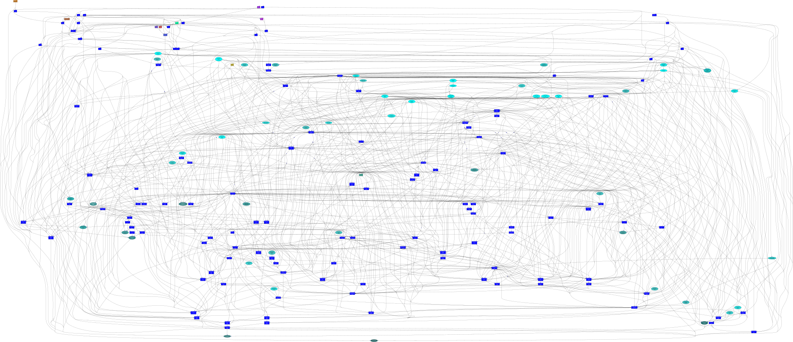
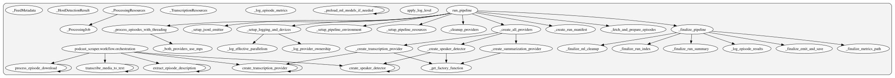
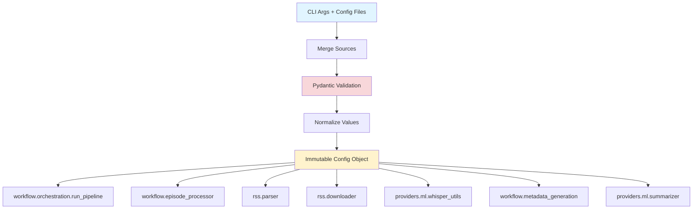
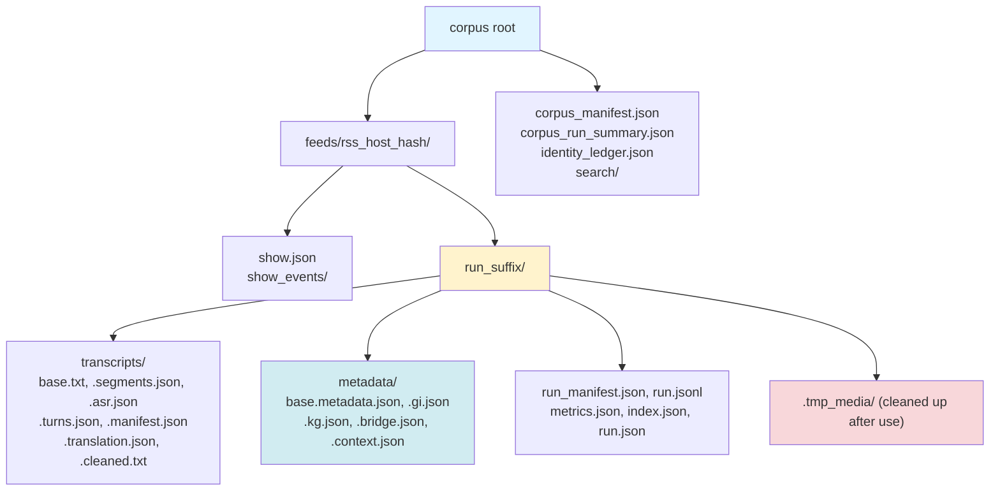

# Podcast Scraper Architecture

> **Strategic Overview**: This document provides high-level architectural decisions, design principles, and system structure. For detailed implementation guides, see the [Development Guide](../guides/DEVELOPMENT_GUIDE.md) and other specialized documents linked below.
>
> **Scope of this repository.** This repository is the platform (ADR-170): the pipeline, the corpus,
> plain search, the operator viewer (Workbench) and the extension seams. It registers **no
> built-in pipeline stages** (`builtin_stage_hooks.py`, `builtin_cli_hooks.py`,
> `builtin_read_hooks.py`). Speakers and diarization, grounded insights (GIL), the identity
> ledger, the advanced KG passes, ad cleaning and audio sync are provided by an installed
> extension through the seams in [ADR-176](../adr/ADR-176-extension-seams-for-the-split.md); without
> one each hook answers its plain default. Sections below that describe those stages say so. The
> app state lives in Postgres ([ADR-169](../adr/ADR-169-the-database-is-the-source-of-truth.md),
> [Database architecture](DATABASE.md)).

## Navigation

This architecture document is the central hub for understanding the system. For detailed information, see:

### Core Documentation

- **[ADR Index](../adr/index.md)** — **The immutable record of architectural laws and decisions**
- **Architecture — [Ways to run and deploy](#ways-to-run-and-deploy)** — CLI vs service vs Docker; one pipeline, one Config
- **[Non-Functional Requirements](NON_FUNCTIONAL_REQUIREMENTS.md)** — Performance, security, reliability, observability, maintainability, scalability
- **[Development Guide](../guides/DEVELOPMENT_GUIDE.md)** — Detailed implementation instructions, dependency management, code patterns, and development workflows
- **[Pipeline and Workflow Guide](../guides/PIPELINE_AND_WORKFLOW.md)** — Pipeline flow, module roles, behavioral quirks, run tracking
- **[Testing Strategy](TESTING_STRATEGY.md)** — Testing philosophy, test pyramid, and quality standards
- **[Testing Guide](../guides/TESTING_GUIDE.md)** — Quick reference and test execution commands
  - [Unit Testing Guide](../guides/UNIT_TESTING_GUIDE.md) — Unit test mocking patterns
  - [Integration Testing Guide](../guides/INTEGRATION_TESTING_GUIDE.md) — Integration test guidelines
  - [E2E Testing Guide](../guides/E2E_TESTING_GUIDE.md) — E2E server, real ML models
  - [Critical Path Testing Guide](../guides/CRITICAL_PATH_TESTING_GUIDE.md) — What to test, prioritization
- **[Server Guide](../guides/SERVER_GUIDE.md)** — FastAPI server, REST API, Workbench, development workflow
- **[Viewer Frontend Architecture](VIEWER_FRONTEND_ARCHITECTURE.md)** — Workbench (Vue SPA) internals: component tree, Pinia stores, API layer, async correctness
- **[CI/CD](../ci/index.md)** — Continuous integration and deployment pipeline

### API Documentation

- **[API Reference](../api/REFERENCE.md)** — Complete API documentation
- **[Configuration](../api/CONFIGURATION.md)** — Configuration options and examples
- **[CLI Reference](../api/CLI.md)** — Command-line interface documentation

### Feature Documentation

- **[Provider Implementation Guide](../guides/PROVIDER_IMPLEMENTATION_GUIDE.md)** — Complete guide for implementing new providers (includes OpenAI example, testing, E2E server mocking)
- **[ML Provider Reference](../guides/ML_PROVIDER_REFERENCE.md)** — ML implementation details
- **[Configuration API](../api/CONFIGURATION.md)** — Configuration API reference (includes environment variables)

### Specifications

- **[PRDs](../prd/index.md)** — Product Requirements
  Documents
- **[RFCs](../rfc/index.md)** — Request for Comments
  (design decisions)
- **[Unified Corpus Ontology (v2)](corpus/ontology.md)** —
  single source of truth for KG v2.0+ and GI v3.0+
  (RFC-097, 2026-06-20); two-tier edge contract,
  `Person`/`Organization`/`Podcast` first-class,
  `ABOUT`/`MENTIONS_PERSON`/`MENTIONS_ORG`,
  `insight_type`+`position_hint`
- **[GIL Ontology](gi/ontology.md)** — Grounded
  Insight Layer node/edge types and grounding contract
  (**superseded by `corpus/ontology.md` for v3.0+**;
  retained for archaeology)
- **[GIL Schema](gi/gi.schema.json)** — Machine-
  readable JSON schema for `gi.json` validation

## Goals and Scope

- Provide a resilient pipeline that collects podcast
  episode transcripts from RSS feeds and fills gaps
  via Whisper transcription.
- Offer both CLI and Python APIs with a single
  configuration surface (`Config`) and deterministic
  filesystem layout.
- Keep the public surface area small (`Config`,
  `load_config_file`, `run_pipeline`, `service.run`,
  `service.run_from_config_file`, `cli.main`) while
  exposing well-factored submodules for advanced use.
- Provide a service API (`service.py`) optimized for
  non-interactive use (daemons, process managers) with
  structured error handling and exit codes.
- Support a **multi-provider architecture** with
  local ML (`MLProvider`: Whisper, Transformers
  summarization, SummLlama) and LLM / API providers
  (OpenAI, Gemini, Anthropic, Mistral, DeepSeek, Grok,
  Groq, Ollama, Qwen, vLLM, a LiteLLM gateway; Deepgram,
  Moss and a self-hosted GPU Whisper for transcription)
  enabling choice across cost, quality, privacy, and
  latency dimensions.
- Define the **Grounded Insight Layer (GIL)** artifact
  contract (`gi.json` schema, PRD-017). The stage that
  extracts insights and verbatim quotes with evidence
  grounding is provided by an installed extension.
- Enable **Knowledge Graph (KG) extraction** from
  transcripts and summaries, producing structured
  topic graphs per episode.
- Provide **semantic corpus search** (PRD-021) via
  LanceDB vector indexing over transcript chunks,
  enabling natural-language queries and episode
  similarity across multi-feed corpora.
- Expose a **read-oriented HTTP API and the operator
  viewer, Workbench** (RFC-062) with corpus library
  browsing (RFC-067), corpus digest (RFC-068), graph
  exploration (RFC-069), and semantic search — served
  as a FastAPI + Vue 3 SPA (`web/workbench`).
- Support **canonical cross-layer identity** (CIL,
  the cross-layer identity design): per-episode **`bridge.json`** joins GIL and
  KG under shared **`person:`** / **`topic:`** / **`org:`**
  ids; **read-only CIL HTTP APIs** and optional
  **transcript hit lift** in semantic search depend on
  aligned **Quote** and **indexed transcript chunk** char offsets.
  The GIL and CIL producers and query routes come with
  the installed extension; the path rules and the
  search-side lift are here.

## Ways to run and deploy

The system has **one pipeline** (`workflow.run_pipeline`) and **one configuration model** (`Config`). Both entry points produce a `Config` and call the same pipeline; only how config is supplied and how results are surfaced differs.

| Mode | Use case | Config source | Entry / deployment |
| ---- | --------- | ------------- | ------------------- |
| **CLI** | Interactive runs, ad-hoc flags, progress bars | CLI args + optional `--config` file | `podcast-scraper <rss_url>`, repeatable `--rss`, `python -m podcast_scraper.cli`. Multi-feed: `--output-dir` required when ≥2 feeds ([CLI.md](../api/CLI.md#rss-and-multi-feed)). Subcommands: `doctor`, `cache`, `corpus-status` (#506). |
| **Service** | Daemons, automation, process managers | Config file only (no CLI args) | `python -m podcast_scraper.service --config config.yaml`. YAML `feeds` / `rss_urls` list runs one pipeline per feed when len ≥ 2. Returns `ServiceResult`; exit code 0/1. For supervisor, systemd, etc. |
| **Docker** | Service-oriented deployment | Config file (default `/app/config.yaml` or `PODCAST_SCRAPER_CONFIG`) | Container runs **service mode**: no CLI arguments, config from file and env. See [Docker Service Guide](../guides/DOCKER_SERVICE_GUIDE.md). |
| **Server (Workbench)** | GI/KG graph, dashboard, semantic search, **Corpus Library**, **index stats / rebuild** | `--output-dir` (corpus path) | `podcast serve --output-dir <path>`. FastAPI + Vue SPA; OpenAPI at **`/docs`**. Needs **`pip install -e ".[dev]"`** (the server dependencies are pinned there). See [Server Guide](../guides/SERVER_GUIDE.md) and [API index — HTTP](../api/index.md#http-viewer-api-server-extra). |

**Programmatic use:** Import `config.load_config_file`, `Config`, and either `workflow.run_pipeline` (returns count + summary) or `service.run` / `service.run_from_config_file` (returns `ServiceResult`). See [API Reference](../api/REFERENCE.md) and [Service API](../api/SERVICE.md).

**Server / Workbench:** `src/podcast_scraper/server/` is the canonical **read-oriented** HTTP layer exposing REST endpoints for the Workbench SPA, plus the database-backed app state (ADR-169). **`routes/platform/*`** remains **stub-only** (not registered in `create_app`) until ADR-064 platform routes land (#50, #347). Installed extensions add routers through `Extension.routers`. OpenAPI: **`/docs`**, **`/openapi.json`**. See [Server Guide](../guides/SERVER_GUIDE.md) for the API contract and [Viewer Frontend Architecture](VIEWER_FRONTEND_ARCHITECTURE.md) for the SPA internals.

## GIL, KG, and canonical cross-layer (CIL) {#gil-kg-and-canonical-cross-layer-cil}

**GIL** (`gi.json`) and **KG** (`*.kg.json`) stay **separate artifacts** ([ADR-052](../adr/ADR-052-separate-gil-and-kg-artifact-layers.md)). KG extraction (`kg/`) ships in this repository; the GIL stage, the bridge builder and the CIL query routes are provided by an installed extension, and this repository owns the artifact contracts, the path rules and the read-side seams. **the cross-layer identity design** adds **`bridge.json`** per episode: a compact list of **canonical identities** (`person:…`, `topic:…`, `org:…`) with **`display_name`** and provenance so HTTP APIs and the viewer can join layers without merging the full ontologies.

**Consumption today:**

- **Workbench** — Loads GI/KG (and bridge where present) via **`GET /api/artifacts`**; graph merge and catalog rows may use bridge paths from metadata ([Server Guide](../guides/SERVER_GUIDE.md), [RFC-062](../rfc/RFC-062-gi-kg-viewer-v2.md)).
- **CIL query API** — Served by the installed extension's routes: filesystem scans for `*.bridge.json` with sibling `gi.json` / `kg.json`; patterns for person/topic arcs and timelines.
- **Semantic search** — **Transcript** hits can expose an optional **`lifted`** object (insight, speaker, topic, quote timestamps) when chunk char ranges overlap a **Quote** and edges/`bridge.json` allow resolution ([Semantic Search Guide](../guides/SEMANTIC_SEARCH_GUIDE.md)).

**Shared implementation seams:** `src/podcast_scraper/builders/bridge_artifact_paths.py` is the single place for **bridge / GI / KG sibling path** rules (metadata → `bridge.json`, `bridge.json` → `gi.json`/`kg.json`, `gi.json` → `bridge.json`). The installed GIL extension normalises **GIL edge `type`** strings for graph walks (CIL queries and search lift) and assembles the **`build_bridge`** payload.

**Operational gate:** Before relying on lift in production-shaped corpora, run **Quote vs chunk offset** verification (`search/gil_chunk_offset_verify.py`, **`make verify-gil-offsets-strict`**) on an indexed run. Details: [Semantic Search Guide — lift and verification](../guides/SEMANTIC_SEARCH_GUIDE.md#chunk-to-insight-lift-and-offset-verification).

**Re-pipeline stance:** Re-running extraction, the bridge builder, or topic clustering **replaces** on-disk artifacts under the corpus root. Canonical ids and `tc:` cluster parents are **not** frozen at first ingest. HTTP APIs and the Workbench read **current** files for the configured path.

## Corpus Topic Clustering Layer {#corpus-topic-clustering-layer}

**Purpose:** Group **semantically similar KG topic nodes** across episodes when LLMs assign different `topic:{slug}` ids for the same real-world subject. This is a **corpus-level, optional** step that sits **beside** per-episode KG extraction and **beside** CIL: it **reads** KG topic labels and embeddings produced for semantic search (RFC-061), writes a small filesystem artifact **`topic_clusters.json`** under `<corpus>/search/` (`search/groupings.py`, built as part of the index rebuild), and can feed **auto-generated** `topic_id_aliases` for CIL. The Workbench may render clusters as **Cytoscape compound parent nodes** without rewriting raw `*.kg.json`.

**Boundaries:**

- **In scope:** Build-time clustering during the index rebuild; HTTP surface to serve the JSON artifact; Workbench overlay only.
- **Out of scope:** Replacing KG extraction, replacing the LanceDB search index, or requiring a database. No query-time external embedding APIs.

Current writers emit **`schema_version`: `"2"`** with distinct **`graph_compound_parent_id`** (viewer) vs **`cil_alias_target_topic_id`** (CIL).

## Insight Clustering Layer (#599) {#insight-clustering-layer}

**Purpose:** Group **semantically similar GI insights** across episodes, so each cluster aggregates supporting quotes from several episodes for cross-episode evidence queries. It reads insight texts from `*.gi.json`, embeds them with sentence-transformers and clusters with the same average-linkage algorithm as topic clustering (default threshold 0.75), writing `insight_clusters.json`.

This layer, the multi-quote GI extraction behind it (#600) and the `insight-clusters` command belong to the GIL stage, so they are provided by the installed extension rather than by this repository. A public-only install has no `gi.json` and therefore no insight clusters.

**Providers:** The providers (local ML and the LLM / API providers) supply transcription and summarization; the capability matrix and selection are in [Provider Deep Dives](../guides/PROVIDER_DEEP_DIVES.md) and the [Pipeline and Workflow Guide](../guides/PIPELINE_AND_WORKFLOW.md). Adding or extending providers: [Provider Implementation Guide](../guides/PROVIDER_IMPLEMENTATION_GUIDE.md).

## Enrichment Layer (RFC-088) {#enrichment-layer}

**Purpose:** A **fourth artifact tier** on top of GIL / KG / bridge. Typed, opt-in *enrichers* run after the core pipeline (as a peer verb, `python -m podcast_scraper.cli enrich`, or auto-chained after a run), read the frozen core artifacts, and write their **own** JSON envelopes under `enrichments/` — cross-corpus signals the Workbench and downstream apps consume for ranking, badges, and discovery. `enrichment/` is a modular framework: protocol + registry + a tier-aware executor (retry / circuit / auto-disable / heartbeat / per-enricher + run cost caps) + a provider-type registry that lets operators pick a backend by name in YAML.

**Boundaries (ADR-104):**

- **In scope:** enrichers that *read* `*.gi.json` / `*.kg.json` / `*.bridge.json` and *write* `enrichments/<id>.json` (corpus scope) or `metadata/enrichments/{stem}.<id>.json` (episode scope) — ranking / scoring / UI-consumption signals only.
- **Out of scope:** enrichers **never modify core artifacts** (immutable after the core pipeline writes them). Graph *traversal / connectivity* that feeds relational queries or LLM grounding is **core pipeline**, not enrichment (e.g. RFC-097 chunk 9's `RELATED_TO` edges). The rubric: *traversal → core, ranking → enrichments*. See [ADR-104](../adr/ADR-104-enrichment-layer-boundary-vs-kg-direct.md).

**What ships here:** the framework and **one deterministic enricher**, `topic_cooccurrence_corpus` (`enrichment/enrichers/`, `PUBLIC_DETERMINISTIC_ENRICHER_IDS`). The other enrichers (the GI-reading ones, embedding / NLI based ones and the query enricher) come from installed extensions through `Extension` enrichment contributions (ADR-168). The embedding and NLI scorers (`enrichment/scorers/`) and the provider-type registry (`enrichment/provider_types/`) are the framework's; whether an extension's ML enricher runs is the operator's choice in profile YAML.

**Accuracy gate (data-driven admission):** an enricher may declare an `accuracy_gate` (a precision floor) on its manifest. `enrichment/eval/admission.py` reads the latest `gate_metrics.json` (shipped inside the package under `enrichment/eval/gate_metrics/`) and, through `profile_sets._admit`, filters the registry → profiles → UI: a gated enricher stays **dark** until an eval records passing precision, and auto-promotes with no code edit once one does. Profiles list *candidates*; the gate decides membership.

**Surfacing:** envelopes reach the **operator viewer, Workbench** (`web/workbench/`) via `/api/corpus/enrichments/*`, and downstream apps through the `/api/app` read routes. Operator control (run / status / health / config / re-enable) is `/api/enrichment/*`. Full reference: [Enrichment Layer Guide](../guides/ENRICHMENT_LAYER_GUIDE.md) + [Enrichment Layer API](../api/ENRICHMENT_LAYER_API.md); spec in [RFC-088](../rfc/RFC-088-enrichment-layer-architecture.md).

## Architectural Decisions (ADRs)

The following architectural principles govern this system. For the full history and rationale, see the **[ADR Index](../adr/index.md)**.

### Core Patterns

- **Concurrency**: IO-bound threading for downloads, sequential CPU/GPU tasks for ML ([ADR-001](../adr/ADR-001-hybrid-concurrency-strategy.md)). MPS exclusive mode ([ADR-046](../adr/ADR-046-mps-exclusive-mode-apple-silicon.md)) serializes GPU work on Apple Silicon to prevent memory contention when both Whisper and summarization use MPS (enabled by default).
- **Providers**: Protocol-based discovery ([ADR-020](../adr/ADR-020-protocol-based-provider-discovery.md)) using unified provider classes ([ADR-024](../adr/ADR-024-unified-provider-pattern.md)), library-based naming ([ADR-025](../adr/ADR-025-technology-based-provider-naming.md)), and per-capability provider selection ([ADR-026](../adr/ADR-026-per-capability-provider-selection.md)).
- **Lazy Loading**: Heavy ML dependencies are loaded only when needed ([ADR-005](../adr/ADR-005-lazy-ml-dependency-loading.md)).
- **Seams for the split**: the stages that left public (GI, speakers and diarization, ad cleaning, the identity ledger) are reached through three hook registries by caller (`stage_hooks.py`, `read_hooks.py`, `cli_hooks.py`). Public registers none of them; an installed extension registers them, and each hook answers its plain default without one ([ADR-176](../adr/ADR-176-extension-seams-for-the-split.md), [ADR-168](../adr/ADR-168-installed-extensions.md)).

### Data & Filesystem

- **Storage**: Hash-based deterministic directory layout ([ADR-003](../adr/ADR-003-deterministic-feed-storage.md)) with flat archives ([ADR-004](../adr/ADR-004-flat-filesystem-archive-layout.md)).
- **Identity**: Universal GUID-based episode identification ([ADR-007](../adr/ADR-007-universal-episode-identity.md)).
- **Metadata**: Unified JSON schema compatible with SQL and NoSQL ([ADR-008](../adr/ADR-008-database-agnostic-metadata-schema.md)).

### ML & AI Processing

- **Summarization**: MAP-REDUCE strategy for long transcripts ([ADR-010](../adr/ADR-010-hierarchical-summarization-pattern.md), [ADR-043](../adr/ADR-043-hybrid-map-reduce-summarization.md)) favoring local models ([ADR-009](../adr/ADR-009-privacy-first-local-summarization.md)).
- **Audio**: Mandatory preprocessing ([ADR-036](../adr/ADR-036-standardized-pre-provider-audio-stage.md)) with content-hash caching ([ADR-037](../adr/ADR-037-content-hash-based-audio-caching.md)) using FFmpeg ([ADR-038](../adr/ADR-038-ffmpeg-first-audio-manipulation.md)) and Opus ([ADR-039](../adr/ADR-039-speech-optimized-codec-opus.md)).
- **Governance**: Explicit benchmarking gates (`ADR-042` (moved to the private eval repo as ADR-011)) and golden dataset versioning (`ADR-040` (moved to the private eval repo as ADR-009)).

### Development & CI

- **Workflow**: Git worktree-based isolation ([ADR-032](../adr/ADR-032-git-worktree-based-development.md)) with independent environments ([ADR-034](../adr/ADR-034-isolated-runtime-environments.md)).
- **Quality**: Three-tier test pyramid ([ADR-019](../adr/ADR-019-standardized-test-pyramid.md)) with automated health metrics ([ADR-023](../adr/ADR-023-public-operational-metrics.md)). The viewer applies its own three-tier variant with production-shaped fixtures ([ADR-095](../adr/ADR-095-viewer-test-pyramid.md), [RFC-086](../rfc/RFC-086-viewer-test-pyramid-and-production-shaped-fixtures.md)) so cross-surface graph handoffs land in a contract test before any fix merges.
- **Viewer graph handoff orchestrator (FSM)**: a single 8-state machine owns every cross-surface graph handoff — Library, Digest, Search, Dashboard, Episode panel, canvas, mini-map ([ADR-094](../adr/ADR-094-graph-handoff-orchestrator-fsm.md), [RFC-085](../rfc/RFC-085-graph-handoff-orchestrator-retrospective.md)). Generation tokens supersede stale work, a 5s wall-clock detector surfaces stuck handoffs via a visible error strip, and a `layoutstop`-driven invariant repairs filteredArtifact ↔ Cytoscape divergence in production. See [VIEWER_GRAPH_SPEC](VIEWER_GRAPH_SPEC.md) and [VIEWER_FRONTEND_ARCHITECTURE](VIEWER_FRONTEND_ARCHITECTURE.md) for the orchestrator wiring.
- **Compose, CI gates, CIL, autoresearch v2, macOS ML safety**: [ADR-084](../adr/ADR-084-full-stack-docker-compose-topology.md) (full-stack Compose), [ADR-085](../adr/ADR-085-ephemeral-stack-test-integration-gate.md) (ephemeral stack-test on `main`), [ADR-086](../adr/ADR-086-canonical-identity-layer-and-bridge-json-cross-layer-join.md) (CIL + `bridge.json`), `ADR-087` autoresearch Track A v2 (moved to the private eval repo as ADR-006), [ADR-088](../adr/ADR-088-macos-local-ci-process-safety-for-ml-workloads.md) (local ML process safety); normative specs in [RFC-079](../rfc/RFC-079-full-stack-docker-compose.md), [RFC-078](../rfc/RFC-078-ephemeral-acceptance-smoke-test.md), `RFC-073` (moved to the private eval repo as RFC-003), [RFC-074](../rfc/RFC-074-process-safety-ml-workloads-macos.md).
- **Cross-surface stack contract (audit table, steady vs recovery):** STACK_CONTRACT and ADR-093 (both not in this repository).
- **Process Safety** ([RFC-074](../rfc/RFC-074-process-safety-ml-workloads-macos.md)): ML model loading (spaCy, Transformers, Whisper) triggers heavy APFS filesystem I/O that can cause macOS kernel lock contention. Mitigations: no ML imports at Makefile parse time, filesystem-only cache checks, pre-commit hook timeout (120s), `cleanup-processes` prerequisite on `ci`/`ci-fast`, offline-mode enforcement (`HF_HUB_OFFLINE`, `TRANSFORMERS_OFFLINE`), and agent rules preventing overlapping `make ci` runs. Diagnostic targets: `make check-zombie` (detects unkillable UE-state processes) and `make check-spotlight` (verifies Spotlight indexing status).

### Reproducibility & Operational Hardening (Issue #379)

- **Determinism**: Seed-based reproducibility for `torch`, `numpy`, and `transformers` ensures consistent outputs across runs. Seeds are configurable via environment variables or config files.
- **Run Tracking**: Comprehensive run manifests capture system state (Python version, OS, GPU info, model versions, git commit SHA, config hash) for complete reproducibility. Per-episode stage timings track processing duration for performance analysis.
- **Failure Handling**: Configurable `--fail-fast` and `--max-failures` flags allow operators to control pipeline behavior on episode failures. Episode-level failures are tracked in metrics without affecting exit codes.
- **Retry Policies**: Three-layer retry for transient errors: (1) urllib3 retry adapters on every HTTP request with configurable counts and exponential backoff (`http_retry_total`, `rss_retry_total`); (2) application-level episode retry that re-runs the entire episode download on transient network errors (`episode_retry_max`, default 1); (3) model loading retry via `retry_with_exponential_backoff`. All retry parameters are configurable via `Config` with resilient defaults active out of the box. See [CONFIGURATION.md -- Download Resilience](../api/CONFIGURATION.md#download-resilience).
- **Timeout Enforcement**: Configurable timeouts for transcription and summarization stages prevent hung operations.
- **Security**: Path validation prevents directory traversal attacks. Model allowlist validation restricts HuggingFace model sources. Safetensors format preference improves security and performance. `trust_remote_code=False` enforced on all model loading.
- **Structured Logging**: `--json-logs` flag enables structured JSON logging for log aggregation systems (ELK, Splunk, CloudWatch).
- **Diagnostics**: `podcast_scraper doctor` command validates environment (Python version, ffmpeg, write permissions, model cache, network connectivity).

## Pipeline and Workflow

The pipeline processes podcast feeds through a sequence of stages: RSS
acquisition, episode selection, transcript download (or ASR transcription),
diarization and speaker naming (extension stage), optional metadata generation, translation to English, optional summarization, optional KG
extraction (and GIL extraction, an extension stage), and optional LanceDB vector indexing. Multi-feed corpora run the inner
pipeline per feed with a single parent index pass. Append/resume mode skips
already-processed episodes.

Per feed, episodes flow through three threads joined by queues: the main thread
detects speakers and downloads, the TranscriptionProcessor thread preprocesses
audio and runs ASR (and, with an extension installed, diarization and naming), and the ProcessingProcessor thread
runs metadata, translation, summaries and KG (and GI with an extension). After the episodes, the feed
is finalized (index, metrics, search index, a queued enrichment job).

For the **full stage-by-stage walkthrough**, pipeline flow diagram, module roles,
multi-feed semantics, and behavioral details see the
[Pipeline and Workflow Guide](../guides/PIPELINE_AND_WORKFLOW.md).

### Module map (summary)

| Package / module | Responsibility | Detail link |
| ---------------- | -------------- | ----------- |
| `cli.py` | CLI entry, arg parsing, multi-feed outer loop | [CLI Reference](../api/CLI.md) |
| `service.py` | Daemon/programmatic entry, `ServiceResult` | [Service API](../api/SERVICE.md) |
| `config.py` | Immutable `Config` model, YAML/JSON loader | [Configuration](../api/CONFIGURATION.md) |
| `workflow/` | Orchestration, stages, degradation, corpus ops, run tracking | [Pipeline Guide](../guides/PIPELINE_AND_WORKFLOW.md) |
| `rss/` | RSS parsing (`defusedxml`), HTTP downloads, feed cache | [RSS Guide](../guides/RSS_GUIDE.md) |
| `providers/` | Unified providers: local ML (`ml/`) and API / LLM providers (`openai`, `anthropic`, `mistral`, `gemini`, `grok`, `deepseek`, `groq`, `ollama`, `qwen`, `vllm`, `litellm`, `deepgram`, `moss`); capabilities, prompts, `extensible.py` (the methods a stage adds to a provider) | [Provider Deep Dives](../guides/PROVIDER_DEEP_DIVES.md), [Provider Guide](../guides/PROVIDER_IMPLEMENTATION_GUIDE.md) |
| `transcription/`, `preprocessing/`, `summarization/`, `cleaning/` | Transcription factory and helpers (language identification, word timestamps, gap recovery); audio preprocessing and `AudioChunker`; summarization factory and fallback wrapper; the pattern-based transcript cleaner | [Audio Pipeline Guide](../guides/AUDIO_PIPELINE_GUIDE.md) |
| `translation/` | The translation stage: units, artifacts, provenance, factory (`gemma_translate` provider under `providers/vllm/`) | [Multilingual Arc](MULTILINGUAL_ARC.md) |
| `providers/tailnet_dgx/` | Self-hosted GPU Whisper transcription over a private network, with its health and telemetry | ADR-096 (not in this repository) |
| `providers/resilience/` | Deployment-agnostic primitives: `CircuitBreaker`, `TimeoutLike`, `run_with_watchdog`, `hardened_http_client` (TCP keepalive + `Connection: close`). Used by `tailnet_dgx/*` today; available to any provider that needs connection-level resilience. | [ADR-105](../adr/ADR-105-response-shape-guardrails-for-self-deployed-services.md) |
| `providers/guardrails/` | Response-shape sanity checks: `check_chat_response`, `check_whisper_response`, `check_diarization_response` — raise `GuardrailViolation` when a `200 OK` response contains semantically-corrupted content (empty, thinking-prose, `finish_reason=length`, malformed JSON). Wired at every chat-completion call site across cloud + self-hosted providers. | [ADR-105](../adr/ADR-105-response-shape-guardrails-for-self-deployed-services.md), [ADR-100](../adr/ADR-100-response-shape-guardrails-for-cloud-llm-providers.md) |
| `stage_hooks.py`, `read_hooks.py`, `cli_hooks.py` | The seams the pipeline, the server's read side and the CLI call by name. The `builtin_*` modules register public's own stages, read hooks and CLI verbs: none today. The GIL stage, speakers and diarization, ad cleaning, the identity ledger and the advanced KG passes come from an installed extension | [ADR-176](../adr/ADR-176-extension-seams-for-the-split.md) |
| `extensions.py` | Installed extensions (entry points): their hooks, routers, CLI verbs, corpus migrations and database modules | [ADR-168](../adr/ADR-168-installed-extensions.md), [ADR-174](../adr/ADR-174-extension-corpus-migrations.md) |
| `identity/` | The display seam every surface reads a person's shown name through (`identity.display`), bare-name scoping and slugs. The ledger behind the display builder comes with the extension | [ADR-176](../adr/ADR-176-extension-seams-for-the-split.md) |
| `db/` | The database layer (ADR-169): settings, per-plane engines, kernel tables, migrations, importers | [Database architecture](DATABASE.md) |
| `upgrade/` | Corpus-upgrade framework: ledger-driven, idempotent migrations (`make upgrade-corpus`) | [Corpus upgrade](../guides/CORPUS_UPGRADE.md) |
| `net/`, `cache/`, `archive/`, `quality/` | Outbound network plumbing (proxy, TLS trust); cache directories and transcript cache; audio-archive tooling; corpus quality assessment | |
| `kg/` | Knowledge Graph extraction (RFC-055); the advanced KG passes are an extension stage | [KG Guide](../guides/KNOWLEDGE_GRAPH_GUIDE.md) |
| `enrichment/` | Enrichment layer (RFC-088): typed enrichers + registry + tier-aware executor + data-driven accuracy gate; writes `enrichments/` envelopes. One enricher ships here (`topic_cooccurrence_corpus`); extensions add the rest | [Enrichment Guide](../guides/ENRICHMENT_LAYER_GUIDE.md), [ADR-104](../adr/ADR-104-enrichment-layer-boundary-vs-kg-direct.md) |
| `search/` | LanceDB vector indexing, semantic search, episode similarity; **corpus topic clustering** (`topic_clusters.json`, topic clustering) | [Search Guide](../guides/SEMANTIC_SEARCH_GUIDE.md) |
| `server/` | FastAPI HTTP layer for the Workbench, corpus catalog, digest, index rebuild, app state | [Server Guide](../guides/SERVER_GUIDE.md), [Viewer Frontend](VIEWER_FRONTEND_ARCHITECTURE.md) |
| `monitor/` | Live pipeline monitor (RFC-065) | [Monitor Guide](../guides/LIVE_PIPELINE_MONITOR.md) |
| `models/` | Shared dataclasses (`RssFeed`, `Episode`, etc.) | |
| `utils/` | Filesystem helpers, progress reporting | |

### Module Dependencies Diagram

```mermaid
graph TB
    subgraph "Public API"
        CLI[cli.py]
        Config[config.py]
        Service[service.py]
        Workflow[workflow/orchestration.py]
    end

    subgraph "Core Processing"
        RSSParser[rss/parser.py]
        EpisodeProc[workflow/episode_processor.py]
        Downloader[rss/downloader.py]
        AudioPreproc[preprocessing/]
    end

    subgraph "Support Modules"
        Filesystem[utils/filesystem.py]
        Models[models/]
        Progress[utils/progress.py]
        Schemas[schemas/summary_schema.py]
    end

    subgraph "Prompt Management"
        PromptStore[prompts/store.py]
        PromptTemplates[prompts/provider/task/v1.j2]
    end

    subgraph "Provider System"
        TranscriptionFactory[transcription/factory.py]
        SummaryFactory[summarization/factory.py]
        Capabilities[providers/capabilities.py]
    end

    subgraph "Local ML Provider"
        MLProvider[providers/ml/ml_provider.py]
        ModelRegistry[providers/ml/model_registry.py]
        Whisper[providers/ml/whisper_utils.py]
        Summarizer[providers/ml/summarizer.py]
        NER[providers/ml/ner_extraction.py]
    end

    subgraph "LLM Providers"
        OpenAIProvider[providers/openai/]
        GeminiProvider[providers/gemini/]
        AnthropicProvider[providers/anthropic/]
        MistralProvider[providers/mistral/]
        DeepSeekProvider[providers/deepseek/]
        GrokProvider[providers/grok/]
        OllamaProvider[providers/ollama/]
        TailnetDgxProvider[providers/tailnet_dgx/]
    end

    subgraph "Provider Cross-cutting"
        Resilience[providers/resilience/]
        Guardrails[providers/guardrails/]
    end

    OpenAIProvider --> Guardrails
    GeminiProvider --> Guardrails
    AnthropicProvider --> Guardrails
    DeepSeekProvider --> Guardrails
    OllamaProvider --> Guardrails
    TailnetDgxProvider --> Resilience
    TailnetDgxProvider --> Guardrails

    subgraph "Semantic Search"
        SearchIndexer[search/indexer.py]
        LanceBackend[search/backends/lancedb_backend.py]
        Chunker[search/chunker.py]
        CorpusSearch[search/corpus_search.py]
        CorpusSimilar[search/corpus_similar.py]
        CorpusScope[search/corpus_scope.py]
    end

    subgraph "Server Layer"
        ServerApp[server/app.py]
        ServerRoutes[server/routes/]
        ServerSchemas[server/schemas.py]
        CorpusCatalog[server/corpus_catalog.py]
        CorpusDigest[server/corpus_digest.py]
        IndexRebuild[server/index_rebuild.py]
        IndexStaleness[server/index_staleness.py]
    end

    subgraph "Knowledge Extraction"
        Hooks[stage_hooks.py: extension stages]
        KG[kg/pipeline.py]
        KGSchema[kg/schema.py]
        KGExtract[kg/llm_extract.py]
    end

    subgraph "Workflow Stages"
        StageSetup[workflow/stages/setup.py]
        StageScraping[workflow/stages/scraping.py]
        StageProcessing[workflow/stages/processing.py]
        StageTranscription[workflow/stages/transcription.py]
        StageMetadata[workflow/stages/metadata.py]
        StageSummarization[workflow/stages/summarization.py]
    end

    subgraph "Optional Features"
        Metadata[workflow/metadata_generation.py]
        CorpusOps[workflow/corpus_operations.py]
        Degradation[workflow/degradation.py]
        Cleaning[cleaning/]
    end

    CLI --> Config
    CLI --> Workflow
    CLI --> ServerApp
    Service --> Config
    Service --> Workflow
    ServerApp --> ServerRoutes
    ServerRoutes --> ServerSchemas
    ServerRoutes --> CorpusCatalog
    ServerRoutes --> CorpusDigest
    ServerRoutes --> CorpusSearch
    ServerRoutes --> IndexRebuild
    ServerRoutes --> IndexStaleness
    CorpusCatalog --> CorpusScope
    CorpusDigest --> CorpusCatalog
    IndexRebuild --> SearchIndexer
    IndexStaleness --> CorpusScope
    SearchIndexer --> LanceBackend
    SearchIndexer --> Chunker
    CorpusSearch --> LanceBackend
    CorpusSimilar --> CorpusSearch
    Workflow --> RSSParser
    Workflow --> EpisodeProc
    Workflow --> Downloader
    Workflow --> TranscriptionFactory
    Workflow --> SummaryFactory
    Workflow --> AudioPreproc
    Workflow --> StageSetup
    Workflow --> StageScraping
    Workflow --> StageProcessing
    Workflow --> StageTranscription
    Workflow --> StageMetadata
    Workflow --> StageSummarization
    Workflow --> CorpusOps
    Workflow --> Degradation
    TranscriptionFactory --> MLProvider
    TranscriptionFactory --> OpenAIProvider
    TranscriptionFactory --> GeminiProvider
    SummaryFactory --> MLProvider
    SummaryFactory --> OpenAIProvider
    SummaryFactory --> GeminiProvider
    SummaryFactory --> AnthropicProvider
    SummaryFactory --> MistralProvider
    SummaryFactory --> DeepSeekProvider
    SummaryFactory --> GrokProvider
    SummaryFactory --> OllamaProvider
    MLProvider --> Whisper
    MLProvider --> Summarizer
    MLProvider --> NER
    MLProvider --> ModelRegistry
    Summarizer --> ModelRegistry
    OpenAIProvider --> PromptStore
    GeminiProvider --> PromptStore
    AnthropicProvider --> PromptStore
    MistralProvider --> PromptStore
    DeepSeekProvider --> PromptStore
    GrokProvider --> PromptStore
    OllamaProvider --> PromptStore
    PromptStore --> PromptTemplates
    Workflow --> Metadata
    Workflow --> Hooks
    Workflow --> KG
    Workflow --> Filesystem
    KG --> KGSchema
    KG --> KGExtract
    KGExtract --> SummaryFactory
    EpisodeProc --> Downloader
    EpisodeProc --> Filesystem
    RSSParser --> Models
    Summarizer --> Models
    TranscriptionFactory --> Capabilities
    SummaryFactory --> Capabilities
```



**Actual import relationships (pydeps):**

The diagram below shows the actual import relationships between modules, generated from code analysis. Compare with the Mermaid diagram above to validate that implementation matches design.



*Generated by [pydeps](https://github.com/thebjorn/pydeps). Regenerate with `make visualize` (requires Graphviz).*

**Workflow call graph (function-level):**

The following diagram shows which functions call which in the pipeline entry point (`workflow/orchestration.py`). Useful for understanding orchestration flow and hot paths.



*Generated by [pyan3](https://github.com/Technologicat/pyan).*

**Flowcharts:** For control flow within key modules, see [orchestration flowchart](diagrams/orchestration-flow.svg) and [service API flowchart](diagrams/service-flow.svg) (generated by [code2flow](https://github.com/scottrogowski/code2flow)).

<!-- markdownlint-disable MD037 -->
- **Typed, immutable configuration**: `Config` is a frozen Pydantic model, ensuring every module receives canonicalized values (e.g., normalized URLs, integer coercions, validated Whisper models). This centralizes validation and guards downstream logic.
- **Resilient HTTP interactions**: A per-thread `requests.Session` with exponential backoff retry (`LoggingRetry`) handles transient network issues while logging retries for observability. Retry counts and backoff factors are configurable via `Config` fields (`http_retry_total`, `http_backoff_factor`, `rss_retry_total`, `rss_backoff_factor`) with resilient defaults (8 retries / 1.0 s backoff for media; 10 retries / 2.0 s backoff for RSS). An additional application-level episode retry (`episode_retry_max`, default 1) re-runs the full episode download on transient network errors after urllib3 retries are exhausted. Model loading operations use `retry_with_exponential_backoff` for transient errors (network failures, timeouts). See [CONFIGURATION.md -- Download Resilience](../api/CONFIGURATION.md#download-resilience).
- **Response-shape guardrails** (ADR-099 / ADR-100): A second layer of defense above transport-level resilience. `providers/guardrails/` runs content-aware sanity checks on every `200 OK` response from chat-completion providers (cloud + self-hosted) and from the self-hosted whisper service and the pyannote diarization response (`check_pyannote_response`). A response that fails the check (empty content, thinking-prose markers, `finish_reason=length`, mid-truncated JSON, empty diarization segments for non-trivial audio) raises `GuardrailViolation`, which the `FallbackAwareSummarizationProvider` wrapper routes the same way it routes connection-level failures. Per-stage policy: summary / KG fail-up (and GI / speaker for the extension's stages); cleaning degrades gracefully to the original transcript. Violations emit a Prometheus counter (`inference_guardrail_violations_total{service, reason}`) for alerting. See [ADR-105](../adr/ADR-105-response-shape-guardrails-for-self-deployed-services.md) (self-hosted), [ADR-100](../adr/ADR-100-response-shape-guardrails-for-cloud-llm-providers.md) (cloud).
- **Concurrent transcript pulls**: Transcript downloads are parallelized via `ThreadPoolExecutor`, guarded with locks when mutating shared counters/job queues. Transcription runs one episode at a time by default (`transcription_parallelism: 1`) to avoid GPU/CPU thrashing with local Whisper; API providers can raise it, and processing (`processing_parallelism`, default 2) overlaps with transcription.
- **Deterministic filesystem layout**: A run writes to `run_<suffix>/` (single feed) or `feeds/rss_<host>_<hash>/run_<suffix>/` (corpus layout), each with `transcripts/` and `metadata/`. Optional `run_id` and Whisper suffixes create run-scoped subdirectories while `sanitize_filename` protects against filesystem hazards.
- **Dry-run and resumability**: `--dry-run` walks the entire plan without touching disk, while `--skip-existing` short-circuits work per episode, making repeated runs idempotent.
- **Pluggable progress/UI**: A narrow `ProgressFactory` abstraction lets embedding applications replace the default `tqdm` progress without touching business logic.
- **Optional Whisper dependency**: Whisper is imported lazily and guarded so environments without GPU support or `openai-whisper` can still run transcript-only workloads.
- **Optional summarization dependency** (PRD-005/RFC-012): Summarization requires `torch` and `transformers` dependencies and is imported lazily. When dependencies are unavailable, summarization is gracefully skipped. Models are automatically selected based on available hardware (MPS for Apple Silicon, CUDA for NVIDIA GPUs, CPU fallback). See [ML Provider Reference](../guides/ML_PROVIDER_REFERENCE.md) for details.
- **Language-aware processing** (RFC-010): A single `language` configuration drives both Whisper model selection (preferring English-only `.en` variants) and NER model selection. Production / cloud profiles default to the transformer-based `en_core_web_trf` for higher entity-recall quality; dev / test paths use the smaller `en_core_web_sm` for speed. Both wheels are pip-installed via the `[ml]` extra in `pyproject.toml`. Profile YAMLs can pin `ner_model:` explicitly to override the default. Language is a resolved, per-episode fact (`languages.py`, `config/languages.yaml`); non-English episodes are translated to English by the translation stage ([Multilingual Arc](MULTILINGUAL_ARC.md)).
- **Speaker detection and host/guest resolution** (RFC-010): provided by an installed extension through the speaker stage hooks (`feed_hosts`, `episode_speakers`, `create_speaker_detector`, ...). Without one the hooks answer their plain defaults: no hosts are detected and no speakers are named. The `speaker_detector_provider` and `ner_model` config fields remain in `Config` for the extension to read. See [Audio Pipeline Guide](../guides/AUDIO_PIPELINE_GUIDE.md).
- **Audio pipeline**: Local Whisper, self-hosted Whisper on a remote GPU host and the cloud transcription providers (`openai`, `gemini`, `mistral`, `groq`, `deepgram`, `moss`) produce transcripts; Deepgram and Moss also return native speaker labels. Cloud providers use **`AudioChunker`** for oversized uploads (#286). Neural diarization (pyannote) and sponsor removal (`remove_commercials`) are extension stages. See [Audio Pipeline Guide](../guides/AUDIO_PIPELINE_GUIDE.md).
- **Provider-based architecture** (RFC-013): All capabilities (transcription, speaker detection, summarization) use a protocol-based provider system. Providers are created via factory functions based on configuration, allowing pluggable implementations (e.g., Whisper vs OpenAI for transcription, local transformers vs OpenAI for summarization). Providers implement consistent interfaces (`initialize()`, protocol methods, `cleanup()`) ensuring type safety and easy testing. See [Provider Implementation Guide](../guides/PROVIDER_IMPLEMENTATION_GUIDE.md) for complete implementation details.
- **Local-first summarization** (PRD-005/RFC-012): Summarization defaults to local transformer models for privacy and cost-effectiveness. API-based providers (OpenAI) are supported via the provider system. Long transcripts are handled via chunking strategies, and memory optimization is applied for GPU backends (CUDA/MPS). Models are automatically cached and reused across runs, with cache management utilities available via CLI and programmatic APIs. Model loading prefers safetensors format for security and performance (Issue #379). Pinned model revisions ensure reproducibility (Issue #379).
- **Reproducibility** (Issue #379): Deterministic runs via seed control (`torch`, `numpy`, `transformers`). Run manifests capture complete system state. Per-episode stage timings enable performance analysis. Run summaries combine manifest and metrics for complete run records.
- **Operational Hardening** (Issue #379): Three-layer retry with configurable parameters and resilient defaults (see [CONFIGURATION.md -- Download Resilience](../api/CONFIGURATION.md#download-resilience)). Timeout enforcement for transcription and summarization. Failure handling flags (`--fail-fast`, `--max-failures`) for pipeline control. Structured JSON logging for log aggregation. Path validation and model allowlist validation for security. End-of-run `failure_summary` in `run.json` aggregates failed episodes by error type for triage.

## Architecture Evolution

The system has evolved through four phases that expand
ML capabilities and enable structured knowledge
extraction. This section documents the architectural
progression and how components integrate with the
existing system.

### Phase 1: Model Registry (RFC-044)

**Status**: **Implemented**

Centralizes all model metadata (architecture limits,
capabilities, memory footprint, device defaults) into
a `ModelRegistry` class in
`providers/ml/model_registry.py`. Eliminates hardcoded
model limits scattered across the codebase. Every model
(summarization, embedding, QA, NLI) is registered with
a `ModelCapabilities` dataclass.

**Impact on existing architecture:**

- `providers/ml/summarizer.py` — uses registry for
  token limits instead of hardcoded values
- `config.py` — registry validates model selections
- Module: `providers/ml/model_registry.py`

### Phase 2: Local ML platform (RFC-042)

**Status**: **Implemented**, with the hybrid MAP-REDUCE provider since **retired**.

RFC-042 introduced a hybrid MAP-REDUCE summarization provider (`summary_provider: hybrid_ml`, LongT5
MAP and a transformers / Ollama / llama.cpp REDUCE). That provider is gone from this repository:
`hybrid_ml` is not a valid `summary_provider` value, and there is no `hybrid_ml_provider.py` and no
`llama-cpp-python` dependency. Local summarization today is `summary_provider: transformers` (MAP and
REDUCE over Hugging Face seq2seq models) or `summllama`; Ollama is a standalone `summary_provider`.
RFC-042 and ADR-043 remain as the design record; the retirement is [ADR-154](../adr/ADR-154-hybrid-map-reduce-retirement.md).

What the phase left in place:

- `providers/ml/embedding_loader.py` — Sentence-transformers for topic deduplication and search
- `providers/ml/extractive_qa.py` — Extractive QA for grounding validation
- `providers/ml/nli_loader.py` — NLI cross-encoders for entailment checking
- `MLProvider` extensions with embedding, QA, NLI models (lazy-loaded)
- Layered transcript cleaning (Issue #419): `transcript_cleaning_strategy` selects the cleaner
  through the `transcript_cleaner` hook; without an extension that is the pattern-based cleaner.

### Phase 2b: Local LLM Prompt Optimization (RFC-052)

**Status**: **Implemented** (parallel with Phase 2)

Creates model-specific prompt templates for Ollama models under `prompts/ollama/`, extending the
existing `PromptStore`; no structural changes.

### Phase 2c: Audio pipeline

**Status**: **Implemented** for the parts this repository ships; the diarization, speaker-naming
and ad-cleaning stages are provided by an installed extension.

Here: `preprocessing/audio/chunker.py` (API upload chunking, #286), `providers/deepgram/`
(Nova-3, #597), `providers/moss/`, `providers/groq/`, the self-hosted GPU Whisper provider, the
single batch progress bar (#19), and the `diarize` / `hf_token` / `deepgram_*` config fields.
Extension: pyannote diarization (#482), speaker and host detection (#269), commercial detection
(#486, #488).

**Impact on existing architecture:**

- `workflow/episode_processor.py` — chunking for API providers; calls the stage hooks after transcription
- `preprocessing/core.py` — `remove_sponsor_blocks` delegates to the `remove_commercials` hook

See [Audio Pipeline Guide](../guides/AUDIO_PIPELINE_GUIDE.md).

### Phase 3: Grounded Insight Layer

**Status**: **Implemented**, in an installed extension (not in this repository).

Structured knowledge extraction in the pipeline:

```text
Transcript → Insight Extraction → Quote Extraction
    → Grounding (Insight↔Quote linking)
    → Topic Assignment → gi.json
```

**Modules:** the GIL pipeline, schema validation, grounding, contracts, exploration, corpus operations,
quality metrics, provenance and run comparison are provided by an installed extension. The `gi.json`
schema stays in `docs/architecture/gi/gi.schema.json`.

**Three extraction tiers (extension behaviour):**

| Tier | Models | Quality | Cost |
| --- | --- | --- | --- |
| ML-only | Local seq2seq + RoBERTa QA + NLI | Good | Free |
| Local LLM | Ollama (Qwen/Llama) + QA | Better | Free |
| Cloud LLM | OpenAI/Gemini + QA | Best | API cost |

All tiers use extractive QA for grounding contract
compliance (every quote must be verbatim).

### Phase 3a: KG Extraction (RFC-055)

**Status**: **Implemented**

Knowledge Graph extraction produces structured topic
graphs from transcripts and summaries.

**Modules (implemented):**

- `kg/pipeline.py` — KG extraction orchestration
- `kg/schema.py` — KG schema validation
- `kg/io.py` — Serializes KG output to `kg.json`
- `kg/llm_extract.py` — LLM-based KG extraction
- `kg/contracts.py` — KG contract enforcement
- `kg/corpus.py` — Cross-episode KG operations
- `kg/quality_metrics.py` — KG quality scoring
- `kg/cli_handlers.py` — KG CLI subcommands

### Phase 3b: Use Cases & Database

**the GIL use-case design** (Use Cases): the CLI commands (`gi inspect`, `gi show-insight`,
`gi explore`) for consuming GIL data belong to the installed extension's CLI verbs.

**RFC-051** (Database Projection) is **superseded by ADR-169**: it projected `gi.json` and the KG
artifacts into Postgres as a read copy, whereas ADR-169 makes the database the source of truth, so
there is no projection to keep in step. See [Database architecture](DATABASE.md).

### Phase 4: Adaptive Routing (RFC-053)

**Status**: Planned

Selects optimal summarization and extraction
strategies based on episode characteristics (duration,
structure, content type). Uses episode profiling and
deterministic routing rules. Enables expansion beyond
podcasts to interviews, lectures, panels, etc.

### Phase 5: Server & Viewer (RFC-062)

**Status**: **Implemented** (M1–M7)

FastAPI server in `src/podcast_scraper/server/` with
the Workbench, a Vue 3 SPA in `web/workbench/`. CLI: `podcast serve`.
See [Server Guide](../guides/SERVER_GUIDE.md) for the
API route table and
[Viewer Frontend Architecture](VIEWER_FRONTEND_ARCHITECTURE.md)
for the SPA internals (component tree, Pinia stores,
API client layer, async correctness).

### Phase 5a: Corpus Search — Hybrid over LanceDB (RFC-061 → RFC-090 → ADR-099) {:#phase-5a-corpus-search}

**Status**: **Implemented.** FAISS semantic search (RFC-061) shipped historically; **hybrid retrieval
(RFC-090) is the default** (v2.7+), and **FAISS was fully retired** (ADR-099, #995) — LanceDB is now
the only search backend.

**Hybrid retrieval (RFC-090, always-on).** A **two-tier** index — transcript **segments** (Tier 1)
and GIL **insights** (Tier 2) — with **BM25 + dense vector fused via RRF** over an embedded **LanceDB**
backend, **compound results** (a segment and its linked insight merged), and rules-based **intent
routing**. The live `/api/search` path routes through the two-tier hybrid `RetrievalLayer`; when no
usable index exists the response is `no_index` — there is **no FAISS fallback** (FAISS retired #995).
KG-proximity was evaluated as a third signal and **rejected** (RFC-091); relational structure comes
from typed edges in the cross-layer graph (`Person→Insight`, `Insight→Entity`,
`Podcast→Episode`, #874) consumed by surfaces — not by ranking.

**Semantic search (sentence-transformers embeddings).** Corpus-wide LanceDB indexing, CLI
(`podcast search`) and HTTP (`/api/search`). Multi-feed corpora use a single unified index under
`<corpus>/search/lance_index/`.

**Index lifecycle (bounded growth).** LanceDB is MVCC and the indexer upserts per document, so
each build appends data fragments + superseded versions. To keep the index bounded across the
**incremental** reindex the pipeline runs after every batch, `build_two_tier_index` **compacts**
each table at the end (`Table.optimize(cleanup_older_than=_COMPACT_RETENTION)` — merges fragments
and prunes versions older than a ~10-minute grace window that keeps superseded fragments readable
for any in-flight api read). Without this the index grew unbounded (a real reprocessed corpus
reached ~3.8G of stale fragments before the fix). A **full** reindex (`index-two-tier`,
`index --rebuild`, `drop_existing`) does **not** delete the index directory — the old `rmtree`
yanked fragment files out from under concurrent readers, stranding them with a `Not found` (#1206).
Instead it clears via MVCC in place: the first flush of each tier `overwrite`-replaces its table
(a new version in the same dir), and any tier that receives no rows is MVCC-emptied at the end, so
readers pinned to the prior version keep resolving their fragments through the retention window.

**Modules (implemented):**

- `search/two_tier_indexer.py` — native two-tier (segment + insight + aux) LanceDB index build
- `search/backends/lancedb_backend.py` — LanceDB BM25 + vector backend
- `search/retrieval.py` — `RetrievalLayer` (signals → RRF → compound dedup)
- `search/hybrid_search.py` — live hybrid bridge (no FAISS fallback; missing index → `no_index`)
- `search/indexer.py` — corpus index build
- `search/chunker.py` — Transcript chunking
- `search/protocol.py` — `VectorStore` / `SearchResult` protocols
- `search/corpus_search.py` — Shared search logic
- `search/corpus_similar.py` — Episode similarity
- `search/corpus_scope.py` — Multi-feed identity
- `search/cli_handlers.py` — CLI subcommands

### Phase 5b: Corpus Library (RFC-067)

**Status**: **Implemented** (Phases 1–3)

Filesystem-backed corpus catalog exposed via
`/api/corpus/*` endpoints. Episode similarity via
search handoff (Phase 3). Viewer Library tab
documented in
[Viewer Frontend Architecture](VIEWER_FRONTEND_ARCHITECTURE.md).

### Phase 5c: Corpus Digest (RFC-068)

**Status**: **Implemented**

Time-windowed episode digest with topic-band
classification. `/api/corpus/digest` endpoint.
Configurable via `config/digest_topics.yaml`. Viewer
Digest tab documented in
[Viewer Frontend Architecture](VIEWER_FRONTEND_ARCHITECTURE.md).

### Phase 5d: Graph Exploration Toolkit (RFC-069)

**Status**: **Implemented** (RFC-069 completed in v2.6.0)

Extends the viewer graph canvas with zoom controls,
minimap, degree filter, and alternative layouts.
Viewer graph internals documented in
[Viewer Frontend Architecture](VIEWER_FRONTEND_ARCHITECTURE.md).

### Execution Order Summary

```text
Phase 1: RFC-044 (Model Registry)       Implemented
Phase 2: RFC-042 (Local ML Platform)    Implemented (hybrid MAP-REDUCE provider retired)
    2b:  RFC-052 (LLM Prompts)          Implemented
    2c:  Audio pipeline                 Implemented here; diarization / naming / ad cleaning in an extension
Phase 3: GIL core design                Implemented (installed extension)
    3a:  KG Extraction (RFC-055)        Implemented
    3b:  RFC-051 (DB Projection)        Superseded by ADR-169
Phase 4: RFC-053 (Adaptive Routing)     Planned
Phase 5: RFC-062 (Server & Workbench)   Implemented
    5a:  Corpus Search (RFC-061→090)    Implemented (Hybrid over LanceDB; FAISS retired #995)
    5b:  RFC-067 (Corpus Library)       Implemented (Phases 1–3)
    5c:  RFC-068 (Corpus Digest)        Implemented
    5d:  RFC-069 (Graph Exploration)    Implemented
```

## Third-Party Dependencies

The project uses a layered dependency approach:
**core dependencies** (always required) provide
essential functionality, while **ML dependencies**
(optional) enable advanced features like transcription
and summarization.

**Core Dependencies** (always installed; see `pyproject.toml`): `requests`, `httpx`, `urllib3`,
`rich`, `defusedxml`, `platformdirs`, `pydantic`, `PyYAML`, `python-dotenv`, `Jinja2`, `filelock`
and the server stack (FastAPI and friends).

**ML Dependencies** (optional, install via
`pip install -e .[ml]`): `openai-whisper`, `spacy` (with the
`en_core_web_sm` and `en_core_web_trf` wheels), `torch`,
`transformers`, `sentencepiece`, `sentence-transformers`,
`accelerate`, `protobuf`. The pyannote diarization stack is not in
`[ml]`; it comes with the package that installs the diarization
stage.

**API Provider Dependencies** (optional `[llm]` extra): `openai`
(also used for DeepSeek, Grok, Groq, Qwen, vLLM and LiteLLM through the
OpenAI-compatible transport), `google-genai`, `google-api-core`,
`anthropic`, `mistralai`, `deepgram-sdk`. Ollama is a separate local
server reached over HTTP.

**Other optional extras:** `[search]` (**LanceDB** plus
sentence-transformers / torch for the two-tier hybrid index; installable without `[ml]`),
`[dev]` (tooling, typecheck, security, and **FastAPI / uvicorn** for the RFC-062 server API),
`[monitor]` (optional profiling, RFC-065), plus the observability extras (`[observability]`,
`[sentry]`, `[langfuse]`, `[otel]`).

For detailed dependency information including
rationale, alternatives considered, version
requirements, and dependency management philosophy,
see [Dependencies Guide](../guides/DEPENDENCIES_GUIDE.md).

## Module Dependency Analysis

The project uses **pydeps** for visualizing module dependencies, detecting circular imports, and tracking architectural health over time. This tooling helps maintain clean module boundaries and identify coupling issues early. The dependency graph is integrated into this document above (see [Module Dependencies Diagram](#module-dependencies-diagram)).

### Tools and Commands

**Makefile Targets:**

- `make deps-graph` - Generate module dependency graphs (SVG) in `docs/architecture/`
- `make deps-graph-full` - Generate full module dependency graph with all dependencies
- `make call-graph` - Generate workflow call graph (pyan3, orchestration entry point)
- `make flowcharts` - Generate flowcharts for orchestration and service (code2flow)
- `make visualize` - Generate all architecture visualizations (deps + call graph + flowcharts) into `docs/architecture/`
- `make release-docs-prep` - Regenerate diagrams and create release notes draft before release, then commit
- `make deps-check` - Check dependencies and exit with error if issues found
- `make deps-analyze` - Run full dependency analysis with JSON report

**Analysis Script:**

- `python scripts/tools/analyze_dependencies.py` - Analyze dependencies and detect issues
  - `--check` - Exit with error if issues found
  - `--report` - Generate detailed JSON report

**Note:** Generating SVG graphs requires [Graphviz](https://graphviz.org/) (`dot` on PATH). Install with `brew install graphviz` (macOS) or your system package manager.

### Key Metrics

| Metric | Description | Threshold |
| -------- | ------------- | ----------- |
| **Max depth** | Longest dependency chain | <5 levels |
| **Circular imports** | Cycles in import graph | 0 |
| **Fan-out** | Modules a file imports | <15 |
| **Fan-in** | Modules importing a file | Monitor only |

### CI Integration

Dependency analysis runs automatically in the **nightly workflow**:

- Generates dependency graphs (SVG) for visualization
- Checks for circular imports
- Runs full dependency analysis with JSON report
- Artifacts are uploaded for download (90-day retention)

### Output Files

- `docs/architecture/diagrams/dependency-graph.svg` - Module dependency graph (clustered, for documentation)
- `docs/architecture/diagrams/dependency-graph-simple.svg` - Simplified dependency graph (clustered, max-bacon=2)
- `docs/architecture/diagrams/dependency-graph-full.svg` - Full dependency graph with all dependencies (from `make deps-graph-full`)
- `docs/architecture/diagrams/workflow-call-graph.svg` - Function call graph for orchestration (from `make call-graph`, pyan3)
- `docs/architecture/diagrams/orchestration-flow.svg`, `service-flow.svg` - Flowcharts for orchestration and service (from `make flowcharts`, code2flow)
- `reports/deps-analysis.json` - Detailed analysis report (when using `make deps-analyze` or script `--report`)

### Related Documentation

- [Architecture visualizations](diagrams/README.md) - Generated diagrams in `docs/architecture/diagrams/`
- [RFC-038: Continuous Review Tooling](../rfc/RFC-038-continuous-review-tooling.md) - Module coupling analysis implementation
- [Issue #170](https://github.com/chipi/podcast_scraper/issues/170) - Module coupling analysis tooling
- [Issue #425](https://github.com/chipi/podcast_scraper/issues/425) - Codebase visualization tools for documentation
- CI/CD Documentation - Nightly workflow details

## Constraints and Assumptions

- Python 3.12+ with the core packages listed above,
  `spacy` (for the speaker stage an extension
  provides), and optionally `openai-whisper` +
  `ffmpeg` when ML transcription is required, and
  optionally `torch` + `transformers` when ML
  summarization is required.
- Network-facing operations assume well-formed HTTPS
  endpoints; malformed feeds raise early during
  parsing to avoid partial state.
- The system supports local ML and a set of API / LLM
  providers with different capability profiles (see
  [Provider Deep Dives](../guides/PROVIDER_DEEP_DIVES.md)).
  Provider selection is driven by `Config` fields
  (`transcription_provider`,
  `speaker_detector_provider`,
  `summary_provider`).
- Whisper transcription supports multiple languages
  via `language` configuration, with English (`"en"`)
  as the default; non-English episodes are translated
  by the translation stage. Transcription runs one
  episode at a time by default (`transcription_parallelism`)
  because of typical GPU/CPU limits; API providers can
  raise it.
- Speaker name detection via NER (RFC-010) is part of the
  speaker stage an installed extension provides. Without
  one, no speakers are detected or named.
- Output directories must live in safe roots (cwd,
  user home, or platform data/cache dirs); other
  locations trigger warnings for operator review.
- GIL extraction (an installed extension's stage)
  produces `gi.json` per episode conforming to a
  versioned schema. The grounding contract requires
  every quote to be verbatim and every insight to
  declare grounding status.
- KG extraction produces `kg.json` per episode with
  structured topic graphs derived from transcripts
  and summaries.

### Configuration Flow



- `models.Episode` encapsulates the RSS item, chosen transcript URLs, and media enclosure metadata, keeping parsing concerns separate from processing.
- Transcript filenames follow `<####> - <episode_title>[ _<run_suffix>].<ext>` with extensions inferred from declared types, HTTP headers, or URL heuristics.
- Transcripts are written to `transcripts/` and metadata documents to `metadata/` inside the run directory; the run suffix distinguishes runs. Screenplay formatting uses detected speaker names when available.
- Temporary media downloads land in `<output>/ .tmp_media/` and always get cleaned up (best effort) after transcription completes.
- Episode metadata documents (per PRD-004/RFC-011)
  are generated when `generate_metadata` is enabled,
  storing detected speaker names, feed information,
  transcript sources, and other episode details
  alongside transcripts in JSON/YAML format for
  downstream use cases. When summarization is enabled,
  metadata documents include summary and key takeaways
  fields with model information and generation
  timestamps.
- **GIL artifacts** (PRD-017): When the GIL stage (an
  installed extension) is enabled, a `gi.json` file is generated per episode
  containing structured insights, verbatim quotes,
  topics, and their grounding relationships. The file
  conforms to `docs/architecture/gi/gi.schema.json` and is
  co-located with other episode artifacts.
- **KG artifacts** (RFC-055): When KG extraction is
  enabled, a `kg.json` file is generated per episode
  containing structured topic graphs.
- **Run tracking files** (Issue #379, #429): The pipeline writes `run.json`, `index.json`, `run_manifest.json`, and `metrics.json` in each run directory. See [Pipeline and Workflow Guide - Run tracking files](../guides/PIPELINE_AND_WORKFLOW.md#run-tracking-files-issue-379-429) for details.

### Filesystem Layout

A single-feed run writes to `<output>/run_<suffix>/`. A multi-feed corpus (and a single feed run with the corpus layout) writes each feed to `<corpus>/feeds/rss_<host>_<hash>/run_<suffix>/`. Each run directory has a `transcripts/` and a `metadata/` subdirectory plus the run-level files. Corpus-level files sit at the corpus root.



`.gi.json`, `.bridge.json`, `.context.json`, `.turns.json`, `identity_ledger.json` and the speaker diagnostics are written by an installed extension's stages; a public-only install does not produce them. See [Corpus Artifacts and Surfaces](CORPUS_ARTIFACTS_AND_SURFACES.md) for the full artifact list.

- RSS and HTTP failures raise `ValueError` early with descriptive messages; CLI wraps these in exit codes for scripting.
- Transcript/Media downloads log warnings rather than hard-fail the pipeline, allowing other episodes to proceed.
- Filesystem operations sanitize user-provided paths, emit warnings when outside trusted roots, and handle I/O errors gracefully.
- Unexpected exceptions inside worker futures are caught and logged without terminating the executor loop.

For detailed error handling patterns and implementation guidelines, see [Development Guide - Error Handling](../guides/DEVELOPMENT_GUIDE.md#error-handling).

## Extensibility Points

- **Configuration**: Extend `Config` (and CLI) when introducing new features; validation rules keep downstream logic defensive. Language and NER configuration (RFC-010) demonstrate this pattern.
- **Progress**: Replace `progress.set_progress_factory` to integrate with custom UIs or disable progress output entirely.
- **Download strategy**: `downloader` centralizes HTTP behavior—alternate adapters or auth strategies can be injected by decorating `fetch_url`/`http_get`.
- **Episode transforms**: New transcript processors can reuse `models.Episode` and `filesystem` helpers without modifying the main pipeline.
- **CLI embedding**: `cli.main` accepts override callables (`apply_log_level_fn`, `run_pipeline_fn`, `logger`) to facilitate testing and reuse from other entry points.
- **Extension seams** (ADR-168, ADR-176): `extensions.py` loads installed extensions through entry points. An `Extension` contributes pipeline stage hooks (`pipeline_hooks`), server routers (`routers`), CLI verbs (`cli_commands`), read hooks, corpus migrations (`corpus_migrations`), enrichers and database modules. This is how speaker detection (RFC-010), diarization, GIL, ad cleaning and the identity ledger plug into the pipeline.
- **Language support**: Language configuration drives both Whisper and NER model selection, enabling multi-language support through consistent configuration. New languages can be added by extending model selection logic and spaCy model support.
- **Metadata generation** (PRD-004/RFC-011): Metadata document generation is opt-in and can be extended with additional fields or alternative output formats. The schema is versioned to support future evolution.
- **Provider system** (RFC-013): The provider
  architecture enables extensibility for all
  capabilities. New providers can be added by
  implementing protocol interfaces and registering in
  factory functions. The providers are local ML and the
  API / LLM providers listed in
  [Provider Deep Dives](../guides/PROVIDER_DEEP_DIVES.md). E2E
  testing infrastructure includes mock endpoints for API
  providers. See
  [Provider Implementation Guide](../guides/PROVIDER_IMPLEMENTATION_GUIDE.md)
  for complete implementation patterns.
- **Prompt templates** (RFC-017): LLM providers use
  versioned Jinja2 prompt templates managed by
  `PromptStore`. New tasks can be added by creating
  `<provider>/<task>/<version>.j2` files. GIL
  extraction prompts will follow this pattern.
- **Summarization** (PRD-005/RFC-012): Summarization
  is opt-in and integrated with metadata generation.
  Local transformer models are preferred for privacy
  and cost-effectiveness, with automatic
  hardware-aware model selection. The implementation
  supports multiple model architectures (BART,
  PEGASUS, LED, DistilBART) and the LLM providers
  via prompt templates. Long transcript handling via
  chunking strategies ensures scalability.
- **GIL Extraction** (PRD-017): The Grounded Insight
  Layer is an opt-in pipeline stage, provided by an
  installed extension, that produces `gi.json` files per
  episode and reuses the provider architecture through
  `providers/extensible.py`. The `gi.json` schema is
  versioned and validated against
  `docs/architecture/gi/gi.schema.json`.
- **KG Extraction** (RFC-055): Knowledge Graph
  extraction is an opt-in pipeline stage that produces
  `kg.json` files per episode. `kg_extraction_source`
  selects `provider` (LLM JSON extraction on the cleaned
  transcript, the default) or `metadata_only` (episode
  and pipeline hosts/guests only, no LLM call).
- **Server / Workbench** (RFC-062): The FastAPI server in
  `server/` exposes REST endpoints wrapping existing
  Python APIs. New route groups can be added by
  creating a router in `routes/` and including it in
  `app.py`. See [Server Guide](../guides/SERVER_GUIDE.md)
  and [Viewer Frontend Architecture](VIEWER_FRONTEND_ARCHITECTURE.md).

## Operational Tooling

Beyond the core `src/` package, the repository includes
standalone tools and scripts that support development,
evaluation, and operations.

### `scripts/` Directory

Utility scripts organized by purpose. All have
corresponding `make` targets — never invoke scripts
directly.

| Folder | Purpose | Key scripts |
| ------ | ------- | ----------- |
| `acceptance/` | E2E acceptance test runners and analysis | `run_acceptance_tests.py`, `analyze_bulk_runs.py` |
| `cache/` | ML model cache management | `preload_ml_models.py`, `backup_cache.py`, `restore_cache.py` |
| `dashboard/` | CI/nightly metrics collection, dashboard generation, JSONL history | `generate_metrics.py`, `generate_dashboard.py`, `consolidate_dashboard_data.py`, `collect_pipeline_metrics.py` |
| `eval/` | Scoring helpers (`score/`); benchmark and evaluation data live in the private eval repository | |
| `tools/` | Dev tooling: dependency analysis, markdown fix, schema validation, testing policy enforcement | `analyze_dependencies.py`, `fix_markdown.py`, `check_unit_test_imports.py`, `check_test_policy.py` |

See `scripts/README.md` for detailed usage and
`make` target mappings.

### `config/` Directory

Runtime configuration organized by use case.

| Folder | Purpose |
| ------ | ------- |
| `acceptance/` | Acceptance fast matrix (`MAIN_ACCEPTANCE_CONFIG.yaml`) + fragments; optional local YAML presets |
| `ci/` | CI-oriented local-only files (gitignored except `README.md`; not used for acceptance fast list) |
| `examples/` | Example YAML/JSON configs and `.env.example` for onboarding |
| `manual/` | Notes for manual configs (the directory holds a README) |
| `profiles/` | Deployment YAML; `profiles/freeze/` for RFC-064 capture presets |
| `schema/` | Config schemas |

Root files: `digest_topics.yaml` (Corpus Digest
topic-band config, RFC-068),
`pricing_assumptions.yaml` (cost estimation),
`languages.yaml` (the language registry; `enabled` gates ingest),
`search.yaml`, and the corpus-format files used by the upgrade
framework (`corpus_snapshot_format.json`,
`corpus_snapshot_reader_support.json`).

## Process Safety for ML Workloads (RFC-074)

ML model loading (spaCy, Transformers, Whisper) involves heavy filesystem
I/O -- `readdir()`, `lstat()`, `mmap()` on multi-GB files. On macOS (APFS),
this contends for a global kernel lock, and processes can enter
uninterruptible wait (`UE` state) where even `kill -9` has no effect.
Repeated `make` invocations (especially from agentic tooling) amplify the
problem into a pileup that can corrupt APFS metadata and prevent login
after reboot.

### Mitigations in the build system

| Layer | Mitigation | Location |
| ----- | ---------- | -------- |
| Makefile parse time | No `$(shell ...)` calls that import ML libraries; `PYTEST_WORKERS` is a static default | `Makefile` |
| ML cache checks | Filesystem-only probes (`config.json` + weight file existence) instead of `AutoTokenizer.from_pretrained()` | `tests/integration/ml_model_cache_helpers.py` |
| CI targets | `cleanup-processes` runs as a prerequisite to `ci` and `ci-fast` | `Makefile` |
| Offline mode | Pytest: `tests/conftest.py`; `make ci` probe: inline env; preload/smoke: `env -u` so Hub works | `Makefile`, `tests/conftest.py` |
| Pre-commit hook | 120-second watchdog timeout; process group cleanup on exit (`kill -- -$$`) | `.github/hooks/pre-commit` |
| Preload script | 1200-second `signal.alarm` hard timeout | `scripts/cache/preload_ml_models.py` |
| Agent rules | *Process safety — ML workloads* in `AGENTS.md`: no retrying stuck commands, no overlapping `make ci`, mandatory `cleanup-processes` after hung runs | `AGENTS.md` |
| Session hook | Cursor `sessionStart` hook runs `check-zombie.sh` to detect UE processes before any work begins | `.cursor/hooks/` |

### Diagnostic targets

```bash
make check-zombie      # Detect unkillable (UE state) Python processes
make check-spotlight   # Verify Spotlight indexing status (macOS)
make cleanup-processes # Kill leftover Python/test processes
```

`check-zombie` and `check-spotlight` are advisory -- they are not wired
into `ci-fast` or `ci` and never block builds. `cleanup-processes` runs
automatically before every `ci` and `ci-fast` invocation.

### Recovery

If `check-zombie` reports UE processes, reboot is the only option. After
reboot, run Disk Utility First Aid on the boot volume. Full recovery
runbook: [RFC-074](../rfc/RFC-074-process-safety-ml-workloads-macos.md#recovery-runbook).

## Testing

The project follows a three-tier testing strategy (Unit, Integration, E2E). For comprehensive testing information:

| Document | Purpose |
| ---------- | --------- |
| **[Testing Strategy](TESTING_STRATEGY.md)** | Testing philosophy, test pyramid, decision criteria |
| **[Testing Guide](../guides/TESTING_GUIDE.md)** | Quick reference, test execution commands |
| **[Unit Testing Guide](../guides/UNIT_TESTING_GUIDE.md)** | Unit test mocking patterns and isolation |
| **[Integration Testing Guide](../guides/INTEGRATION_TESTING_GUIDE.md)** | Integration test guidelines |
| **[E2E Testing Guide](../guides/E2E_TESTING_GUIDE.md)** | E2E server, real ML models |
| **[Critical Path Testing Guide](../guides/CRITICAL_PATH_TESTING_GUIDE.md)** | What to test, prioritization |
| **[Provider Implementation Guide](../guides/PROVIDER_IMPLEMENTATION_GUIDE.md)** | Provider-specific testing |
| **[Server Guide](../guides/SERVER_GUIDE.md)** | Server API testing, Playwright E2E |
