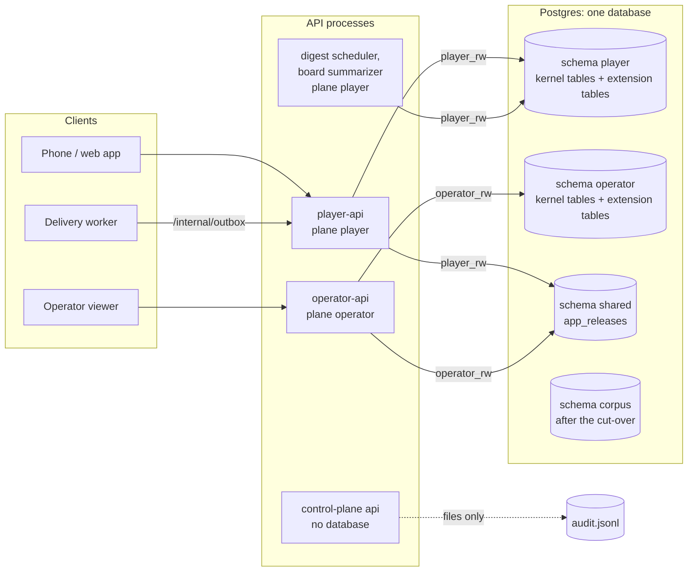

# Database architecture

App state lives in Postgres 18 and, after the corpus cut-over, the corpus will too
([ADR-169](../adr/ADR-169-the-database-is-the-source-of-truth.md)). This page explains how the
platform's part of the database is put together: the schemas and roles, how a process reaches its
data, how the schema changes, how file stores are imported, and the traps. The physical tables
are in the generated [kernel diagram](diagrams/database-kernel.md), which a test keeps equal to
the table definitions. Installed extensions own further tables and document them in their own
repositories.

## Logical picture

- **Planes** ([ADR-116](../adr/ADR-116-privilege-split-public-control-api.md)): each API plane has
  a schema and a role of its own, and its own accounts. A plane role cannot read the other plane.
- **`shared`** ([ADR-171](../adr/ADR-171-shared-schema-for-cross-plane-rows.md)): the only rows
  both planes read and write: today each client app's released version.
- **The control-plane API runs without a database** by design. The stores it touches behave as
  their absent file did (no access-policy override, no release override), and its audit trail
  stays a JSONL file.
- **Roles** (created by the deploy, not by migrations): a migrating role that owns the schemas and
  runs DDL, one read-write role per plane, a pipeline role for the corpus, a monitor role. The
  plane roles may read but not write the migration bookkeeping (`alembic_version*`,
  `schema_history`).

## How a process reaches its data

1. **Settings**: `PODCAST_DATABASE_URL` (and an optional read-only URL), `PODCAST_DB_PLANE`. A
   secret file under `/run/secrets` stands in when the variable is empty, so a `docker exec` sees
   the same database as the server (`db/settings.py`).
2. **Engines, once per process** (`db/engines.py`): a read-write and a read-only engine, both with
   `schema_translate_map={None: plane}`, a pool sized by `PODCAST_DB_POOL_SIZE` /
   `PODCAST_DB_MAX_OVERFLOW` (5 + 5) that gives up waiting after `PODCAST_DB_POOL_TIMEOUT_S` (10 s),
   `pool_pre_ping`, and `application_name` from `PODCAST_DB_APPLICATION_NAME` (else
   `OTEL_SERVICE_NAME`), so `pg_stat_activity` and the server log name the container. Every app
   connection also carries `statement_timeout` (`PODCAST_DB_STATEMENT_TIMEOUT_MS`, 15 s) and
   `idle_in_transaction_session_timeout` (`PODCAST_DB_IDLE_TX_TIMEOUT_MS`, 60 s) through libpq
   `options`; `PODCAST_DB_PREPARE_THRESHOLD` (`none` disables server-side prepared statements, for
   PgBouncer). A request holds a connection only for a query or transaction
   ([ADR-173](../adr/ADR-173-how-the-app-uses-database-connections.md)).
3. **Readiness at start**: both engines connect, and each schema must be at the code's head or
   ahead of it (see Gotchas).
4. **Stores keep their functions**: a store module's functions keep the names and signatures they
   had as file stores (`data_dir` stays the first argument); the database comes from the engine
   registry. Reads go through `read_with_retry` on the read-only engine (a read of one statement on
   `read_connection`: autocommit, so no BEGIN and ROLLBACK round trips); writes open a
   transaction on the read-write engine.
5. **Kernel tables carry no schema**; the engine places them in the plane. Tables in `shared` name
   their schema.

## How the schema changes

- **Alembic, driven from code** (`db/migrate.py`; no `alembic.ini`): `db upgrade --plane P` brings
  `shared` to its head, then the plane's kernel history, each in its own transaction, and writes a
  `schema_history` row per applied revision with the release it came from. `db upgrade --sql`
  prints the SQL and executes nothing; `db status` exits 2 when anything is behind.
- **Never at app start**: prod's migrate step dumps the plane and `shared` first, reads the SQL,
  upgrades as the migrating role, then re-applies the grants.
- **Expand-only within a release**, so the previous release keeps working on the migrated
  database.
- **Module histories** ([ADR-172](../adr/ADR-172-module-migration-histories-and-readiness.md)):
  an installed extension that owns tables sets `Extension.database` to a `DbModule` (name,
  scripts, metadata, planes, `after`, importers). On each plane in `planes` its history runs
  after the kernel's and after every module named in `after`, keeps `alembic_version_<name>` in the plane schema, and writes the plane's
  `schema_history`. Its tables and revision ids start with `<name>_` and name no schema
  (`validate_module` refuses anything else); its tables may reference `users` with
  `ON DELETE CASCADE`, so deleting an account stays one transaction. `db status`, `db upgrade
  --sql` and the start-up check cover every module history.

## How file stores are imported

`db import --from-files <APP_DATA_DIR> --plane P [--only STORE] [--dry-run]` (`db/importers/`):

- one importer per store, users first, since per-user rows reference `users`;
- each reads its files exactly as the file store read them, inserts what is missing, and then
  compares every record with what the database holds; a mismatch, an unreadable file or a file of
  a user with no account fails the run;
- logs (append-only files) import whole: an empty table gets every line, a table holding exactly
  the file's lines is "already present", anything else is a mismatch;
- the **inventory** (`db/inventory.py`) walks the whole directory and classes every file as
  imported, still a file, ignored (locks), retired or ops; a file nothing claims is UNCLAIMED and
  fails the run, so a cut-over cannot silently leave a store behind. Extensions declare their own
  files (`Extension.app_data_files`).

## Design elements

- **Account deletion is one transaction** for everything with a foreign key: extension hooks run
  first (they revoke credentials, and a failure leaves the account to retry from), then one
  transaction deletes the outbox envelopes and throttle row (no foreign key: a sign-in envelope
  predates its account) and the `users` row, whose foreign keys cascade to every per-user table,
  then the directory of stores that are still files.
- **JSONB only for data read whole per row** (a consent matrix, an envelope, a free-form
  preferences object); anything filtered, joined or counted is a column.
- **Single queries for the fan-outs**: the unsubscribe link is one indexed lookup on
  `unsubscribe_ref`; the outbox poll joins each pending envelope to its consent row; handle
  allocation is the `UNIQUE` constraint.
- **Single use by constraint**: a magic link is claimed by `INSERT … ON CONFLICT DO NOTHING`, the
  send throttle by one conditional upsert keyed by a hash of the address.
- **Fail closed where it matters**: a database error reading the access policy is raised, never
  read as "no policy" (which would re-admit addresses revoked through the admin endpoint).
- **Observability**: database errors group in GlitchTip by driver class plus SQLSTATE, with no
  SQL or parameters sent; psycopg spans sit under each request's trace.

## Gotchas

- **Readiness allows a database ahead, from this release on.** `check_ready` starts when each
  schema is at the code's head or ahead of it: at a revision the code does not ship, with the
  code's head in that schema's `schema_history`
  ([ADR-172](../adr/ADR-172-module-migration-histories-and-readiness.md)). The releases before it
  (f3606a2 and earlier) refuse any mismatch, so they are a rollback target only while nothing has
  migrated past them. The check reads `schema_history` as the plane role: without SELECT on a
  schema's `schema_history` (`shared`'s too), an ahead database reads as unknown and the process
  refuses to start.
- **`schema_translate_map` maps only `None`.** A kernel table given a schema escapes the plane; a
  `shared` table without one lands in the plane. `test_db_migrate.py` checks the migrations name
  only the schema they are given, and `compare_metadata` checks `schema.py` against them.
- **Raw `text()` SQL is not placed in the plane.** `schema_translate_map` rewrites only
  SQLAlchemy table objects; a table named inside a `text()` string stays as written. Stores use
  Core tables, or name the schema from `plane_schema()` explicitly.
- **`read_with_retry` is for reads only.** It retries a dropped connection; wrapping a write in it
  could apply the write twice.
- **`read_connection` is for a read of ONE statement.** It runs in autocommit, so two statements on
  it do not share a snapshot; a read that needs one uses `engine.connect()`. The read-only guard
  (`default_transaction_read_only`) still applies. The app releases are also kept in the process
  for 5 s (`app_release_store.CACHE_SECONDS`): a write in the same process drops them at once,
  another process's write shows within 5 s.
- **A statement over 15 s is cancelled** (SQLSTATE 57014, `QueryCanceled`; GlitchTip groups it by
  class and SQLSTATE), and a transaction idle for 60 s loses its connection. A query that needs
  longer raises its own limit with `SET LOCAL statement_timeout` in its transaction, or runs
  outside the API. Migrations and importers pass `-c statement_timeout=0` and
  `-c idle_in_transaction_session_timeout=0` (`unbounded_connect_args`), which overrides any
  role-level default on the plane roles.
- **Pool x engines x workers x processes must stay under the server's `max_connections`** (or
  PgBouncer's pool). Each process opens two engines, rw and ro. A starved pool raises
  `TimeoutError` after the pool timeout instead of hanging.
- **No session state in app code.** Session advisory locks (use `pg_advisory_xact_lock`),
  session-level `SET`, LISTEN/NOTIFY, temp tables and `WITH HOLD` cursors would break PgBouncer in
  transaction mode; `test_db_session_state_policy.py` fails on them. Connection settings go in the
  engines' `options`.
- **Engines reconnect by themselves after a server restart** (`pool_pre_ping`): the first query
  during the restart fails, the next one opens a new connection. Writes during the restart fail
  and are not retried.
- **The migrating role has no `CREATE` on the database** in prod: `upgrade` creates a schema only
  when it is missing, because Postgres checks `CREATE` before `IF NOT EXISTS`. The deploy creates
  the schemas.
- **Grants must not depend on run order.** The deploy grants each plane role DML on its tables and
  then narrows the bookkeeping to SELECT in the same step. Each module's `alembic_version_<name>` is
  bookkeeping too and gets the same narrowing.
- **Tests: import psycopg's JSON adapter at collection.** `tests/_database.py` imports
  `psycopg.types.json` and SQLAlchemy's psycopg dialect up front, because a module first imported
  inside a test's `patch.dict(sys.modules, …)` window is evicted at its exit, and psycopg then
  cannot adapt the re-imported `Jsonb` class.
- **Where a local test run gets its database**: with `PODCAST_TEST_DATABASE_URL` unset and `CI`
  unset, the pytest controller provides one before the workers start: this checkout's
  `make test-db-up` container if it is running (asked for its live URL, so a `docker restart` no
  longer matters), else an embedded PostgreSQL 18 from the `[dev]` extra, started in a temp dir for
  the run and deleted at its end. Neither gives one error at start. An exported URL is used as is,
  and goes stale if the container restarts.
- **A dry-run import on an empty database** counts every user directory with a `profile.json` as
  an account to be, so per-user stores are not refused for lack of a `users` row.

## Keeping this page true

- The [kernel diagram](diagrams/database-kernel.md) is generated
  (`python -m podcast_scraper.db.diagram --out docs/architecture/diagrams/database-kernel.md`);
  `tests/unit/podcast_scraper/db/test_db_diagram.py` fails when it is stale, so a migration lands
  with its diagram.
- A change to a database decision changes its ADR (169, 171, 172 here) and this page in the same
  pull request.
