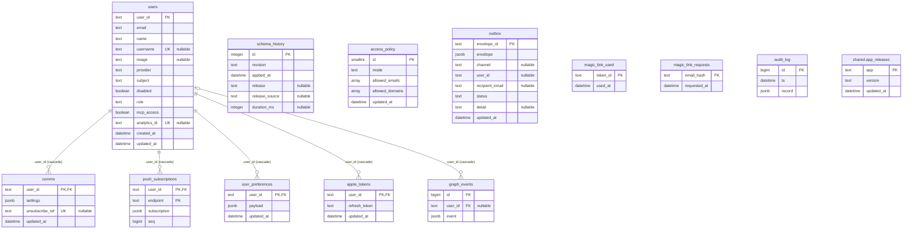

<!-- Generated by `python -m podcast_scraper.db.diagram`; do not edit by hand. -->

# Kernel and shared schema: the physical diagram

Tables without a schema live in each plane's schema (`player`, `operator`); the `schema_translate_map` of the process's engine places them. Tables with a schema name it.

## Constraints and indexes

| Table | Constraints and indexes |
| --- | --- |
| `users` | UNIQUE `users_analytics_id_key` (analytics_id) UNIQUE `users_provider_subject_key` (provider, subject) CHECK `users_role_check`: `role IN ('listener', 'creator', 'admin')` UNIQUE `users_username_key` (username) |
| `schema_history` | — |
| `access_policy` | CHECK `access_policy_mode_check`: `mode IN ('allowlist', 'open')` CHECK `access_policy_single_row`: `id = 1` |
| `comms` | UNIQUE `comms_unsubscribe_ref_key` (unsubscribe_ref) FK `user_id` → `users.user_id` ON DELETE CASCADE |
| `push_subscriptions` | FK `user_id` → `users.user_id` ON DELETE CASCADE |
| `user_preferences` | FK `user_id` → `users.user_id` ON DELETE CASCADE |
| `apple_tokens` | FK `user_id` → `users.user_id` ON DELETE CASCADE |
| `graph_events` | INDEX `graph_events_user_idx` (user_id, id) FK `user_id` → `users.user_id` ON DELETE CASCADE |
| `outbox` | CHECK `outbox_status_check`: `status IN ('pending', 'delivered', 'bounced', 'complaint', 'suppressed', 'failed')` INDEX `outbox_pending_idx` (channel, updated_at) WHERE `status = 'pending'` INDEX `outbox_recipient_idx` (recipient_email) INDEX `outbox_user_idx` (user_id) |
| `magic_link_used` | — |
| `magic_link_requests` | — |
| `audit_log` | — |
| `shared.app_releases` | CHECK `app_releases_app_check`: `app ~ '^[a-z][a-z0-9_]{0,31}$'` CHECK `app_releases_version_check`: `version ~ '^[0-9]{1,4}(\.[0-9]{1,4}){0,3}$'` |
