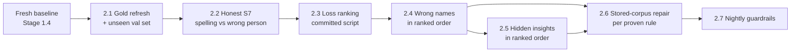

# Ingestion arc: the deploy today, then wrong names first (opened 2026-10-19)

The one plan for ingestion and naming work. It replaces the naming strategy, handovers and roadmaps
that were in `docs/wip/` (list at the end). Every data change in it goes through the method,
[CORPUS_CHANGE_METHOD.md](../guides/CORPUS_CHANGE_METHOD.md), and its change gate
(`docs/wip/changes/`, `config/corpus_change_gate.json`); every regime migration also goes through
the outcome hook. Nothing here is an exception to them.

## The goal

A listener sees every insight under the person who said it, wherever the episode's own text and
audio make that knowable. Where they do not, we say so honestly.

- **A wrong name is worse than a hidden insight** (operator, 2026-10-19). A hidden insight is a
  loss; an insight under the wrong person is a false statement. Every ranking in this plan weighs
  wrong-person insights above hidden ones.
- **No gating number gets worse** (method principle 5, with its trade rule).
- **We build on what we have and never step back.** Each step leaves the corpus, the gold sets and
  the instruments at least as good as before, measured, and its output is an input of the next.

## How we pick up and close work

1. **The method for every change.** Intake, outcome, diagnosis by loss, a dated prediction in
   integers, a fresh reviewer's acceptance before code, build, measure on a snapshot clone, a
   fresh reviewer's verdict, the operator's review. The gate refuses code edits that skip a step.
2. **Instruments before rules.** A fix is judged by a number. If the number is unreliable, fix the
   number first.
3. **Rank by measured loss, insight-weighted, wrong names first.** The ranking script decides the
   order, not my guess.
4. **One item solid before the next.** Done means measured, reviewed and closed, with nothing
   unvalidated left behind.
5. **Rules generalise.** A rule is designed on the dev gold set and scored once on an unseen
   validation set. Nothing is tuned to make a number look good.
6. **Prod fixes are text-file fixes.** No DGX, relabel, LLM call or full search-index rebuild.
   The ladder: read-time fix, deterministic migration, targeted index-row edits, deterministic
   re-runs for the affected episodes only.
7. **Deploy only if better.** A deploy carries changes that passed the method's deploy gate on a
   snapshot clone. The operator decides.

## Stage 0: today, the deploy (2026-10-19)

Owner: the prod session, which runs prod, holds the SSH key and takes the operator's go directly.
This session supports it and does not dispatch. The full runbook is with the prod session
(`~/.local/state/corpus-migration/podcast-0031/STEPS.md`); the outline:

1. **CI on the deploy sha, e151a5c07.** Python application, then Stack test, which publishes the
   `sha-e151a5c` images (about an hour). 0031's code digest at e151a5c07 is `5d5477d0…`, equal to
   the shipped outcome's (prod session, checked). Freeze: no commit inside 0031's import closure
   (667 of the 737 files under `src/podcast_scraper/`) until 0031 is applied.
2. **Deploy.** Preflight, the operator's go, `deploy-all-prod.yml`, the gate, the box verify (every
   app container on the sha), the smokes, `deploy-verify compare` against the 06:35Z baseline.
   Infra post-deploy steps, owned by the prod session:
   [AFTER-NEXT-DEPLOY-2026-10-17.md](AFTER-NEXT-DEPLOY-2026-10-17.md) (Caddy IPv6, `unscoped.alloy`,
   the prod-ops-health timer).
3. **0031 apply.**
   - The corpus is idle.
   - The dry run on the new code stops on exactly one `clone_only` episode, reprocessed on prod on
     10-17, with its cause recorded in the 0031 record.
   - The operator's apply go, given to the prod session.
   - `upgrade run` with the accept file, the snapshot kept.
   - Exit 0 and a receipt reading PASS, then verify and the ownership fix.
4. **Derived surfaces, from prod's census, not a list.**
   - Re-enrich the written episodes' `insight_density` and `insight_sentiment` sidecars (only
     deterministic enrichers).
   - An incremental `index` for the affected episodes, never `reindex-prod.yml` (a full rebuild).
     The removed identity's dead rows are listed before any targeted delete.
   - Transcript manifests and anonymised transcripts: refreshed per the census.
   - Corpus-level enrichers: the next nightly.
5. **Re-measure.** The hook's receipt compares every episode exactly. Expected on prod: S1 −1,336,
   S1n −1,779, S2 −1,862, S3 −526, S10a −11, others 0. Spot checks: three written episodes, and the
   Jessica Espinoza episode, whose wrong name "Justin Norman" is removed.

**Stage 0 ends when** the receipt reads PASS, the spot checks hold, and the derived surfaces the
census lists are refreshed. If anything is off, the prod session stops and reports to this session.

## Stage 1: close the deploy (the days after)

1. **0031's record:** steps 11 (after the apply) and 12 (the retrospective, into the method's
   changelog), with prod's numbers against the prediction.
2. **Close on evidence:**
   - **#2380:** the receipt.
   - **#2082:** `make transcript-pairing-audit` exits 0 on the live corpus. Its code shipped in
     September; the live audit waited for prod's checkout to update.
   - **#2332:** prod reports 91 of 91 episodes; the issue counts 96. Account for the 5, then close.
3. **The freeze lifts.** The stale-outcome check moves from every main CI run to the deploy path
   (`deploy-all-prod.yml`) and the prod hook, which already refuses a stale outcome. Other
   sessions' commits then stop turning main red. The hook's closure size (667 files) is revisited
   in the same change.
4. **A fresh prod snapshot, after 0030, 0031 and #2332: the new baseline.** On it, the scoreboard
   (S1–S3, S9–S12, A1) and S7/S8. This replaces the 10-16 table below as "where we are".
5. **`upgrade verify` exits 0 on prod.** It exits 1 after the apply, on two lines; 0031's own line
   passes:
   - **0029, the Espinoza episode:** 0031 removed "Justin Norman" on the reviewer's WRONG_PERSON
     verdict, and 0029's verify still expects its own list's name. Fix: 0029's verify reads the
     reviewer verdicts and expects a WRONG_PERSON entry in its restored state, as 0031's does.
     Reproduced on the clone: before 0031, 0029 failed on 2 leftover episodes, both of which 0031
     wrote; after 0031, it fails only on Espinoza.
   - **0015, David Roblin (run 20261014-073935):** fails identically before and after 0031 (clone
     and prod's 10-17 verify). It is older than this change; it gets diagnosed from the files and
     fixed.
   - **The method change this calls for:** step 7 runs the full `upgrade verify` on the clone's
     after-state, every applied migration's verify and not only the change's own. A change that
     contradicts an earlier migration's verify is then predicted, not discovered on prod. It was
     missed for 0031.
6. **The dead search row:** the one `kg_entity` row that still ties the Espinoza episode to
   `person:justin-norman`. A targeted delete, on the operator's go.
7. **Scratch:** the 10-16 clones (`lost/clone30L`, `lost/gateworkB6c`) are deleted once the new
   baseline exists.

## Stage 2: the next arc, wrong names first

The critical path. Each step is a change through the method, and each output is the next step's
input, so nothing is redone or undone.

1. **Gold refresh (2.1).** This improves the gold.
   - Re-cut the 51 stale gold cases (their labelled run is no longer served) as a new labels
     version on the new baseline.
   - Draw a new unseen validation set: half sampled in proportion to hidden insights per feed, half
     uniform. val_v1 becomes development-tier (strategy item 1f, never done).
   - Exit: every set pinned to the new snapshot; the skipped count reported per set.
2. **Honest S7 (2.2).** This improves the evaluation.
   - Today S7-wrong counts ASR and metadata spellings ("Deborah Kamen" for "Debra Kamin") as the
     wrong person: 2,128 wrong of 13,740 named insights on val_v1 after 0031 is an upper bound.
   - Split the matcher's outcome into same-person-misspelled and other-person, measured both ways
     on gold: a right correction, and a "correction" onto another person.
   - Exit: S7-wrong counts only other people, with the reviewer's re-derivation.
3. **Loss ranking (2.3).** A committed script on the new baseline.
   - Wrong-person insights grouped by pattern, from S7's per-insight rows.
   - Hidden insights grouped by the stored naming decision (`inputs.llm_resolution.verdicts`:
     invented, third_person, duplicate, unmapped_voice, role_only, abstained) and by #2200's
     buckets.
   - Exit: the ordered worklist, wrong-person classes first.
4. **Wrong names, in ranked order (2.4).** Expected to be near the top; the ranking decides:
   - **0029's 22 unreviewed entries:** 556 shown insights whose names nobody has read. Review them
     the way 0031's entries were, write the verdicts, and repair them with a migration.
   - The rules: #2367 (wrong rosters), #2352 Open 1 and 2 (swapped first-name hosts, merged
     near-identical names), K1 swaps (#2333), F4a (the guest's name on the host's voice), the
     Espinoza class (a wrong person under a stated name).
   - The misspelled-name correction, against names the episode's metadata states.
   - Exit per rule: S7-wrong falls by the predicted amount, S6 = 0, no gating number rises.
5. **Hidden insights, in ranked order (2.5).** Candidates:
   - #2200 bucket A (the model found the name, a guard discarded it);
   - junk known-host pools;
   - #2364 (Patreon supporters published as guests);
   - #2363 (a name in the middle of a title is not a stated spelling);
   - F4 (a guest seated as host);
   - a network ad tag diarized into its own voice (the 7 known Phase C regressions);
   - F12 (a sponsor read after "my guest is X" takes the introduced name).

   What text cannot decide goes on the LLM-would-solve list, not into a rule: #2366 silent hosts,
   solo splits in stored episodes, S8's undecidable voices.
6. **Stored-corpus repair (2.6).** One text-only migration per proven rule, through the gate and the
   hook, judged on a snapshot clone; derived surfaces from the census.
7. **Guardrails (2.7).** The nightly alert when S1, S1c, S5 or S7-wrong rise or S4 falls (#2334
   S8); the scoreboard numbers as `/metrics` gauges, so they have a history.

**The arc ends when** S7-wrong and S1 have fallen by the predicted amounts on the gold sets and on
the corpus, nothing gating rose, and the guardrails are live.

## Parallel tracks, not on the critical path

- **ASR:** #2353 (repeated or invented lines at the end), #2370 (two passages at the same
  timestamps), #2368 (punctuation repair refusals).
- **Non-English:** #2187 (ASR on non-English audio) and #2251 (the translation model), both on the
  DGX. The operator schedules them.
- **0032** (the re-derivation of 166 voices): reworked only if the ranking puts its cases high.
  Its 166 entries need the deciding-evidence re-read first; the Hard Fork pair is known wrong.
- **Ad copy:** 357 ad-marker hits in served text (A1); 28 ad maps already off their transcripts.
- **Voice identity:** forward capture only (option A,
  [VOICE-IDENTITY-DESIGN-2026-10-12.md](VOICE-IDENTITY-DESIGN-2026-10-12.md)); the operator may
  return to it.
- **Instruments still missing:** a census of everything that reads insight visibility (search rows,
  sidecars, clusters, corpus enrichers); the 7 named-but-hidden insights left after 0031.
- **The roster loss** found by 0031's review (L8), for the operator.

## Carried over from the deleted plans

Ideas the ranking (2.3) will place, so none is lost:

- **A per-show host as a graph edge** (`person —HOSTS→ show`), and a per-feed `known_hosts`
  config (from the host-identification epic and the speaker-resolution roadmap).
- **The opener rule's 7 known regressions:** the network ad tag diarized into a voice, so the
  opener test sees whoever speaks first after the tag (Phase C handover).
- **The failure inventory of 2026-10-11:** F4, a guest seated as host (41, heuristic); F12, a
  sponsor read taking the introduced name (naming coverage plan).
- **The non-English defects:** first-name address swaps (es) and near-identical names merging (de),
  tracked in #2352.

## Where we are

The 10-16 snapshot with 0030 (the clone 0031 was measured on), after 0031. To be replaced at
Stage 1.4 by the fresh baseline.

| Metric | Before 0031 | After 0031 |
| --- | ---: | ---: |
| S1: hidden, voice unknown | 16,211 | 14,841 |
| S1n: named but hidden | 1,786 | 7 |
| S2: hidden, all causes | 28,247 | 26,351 |
| S3: principal voices unidentified | 8,236 | 7,710 |
| S10a: episodes with no visible insight | 190 | 178 |
| S1c, S12, A1 | 0, 24, 357 | unchanged |
| S7 on gold, val_v1 (correct / wrong / unnamed) | 11,612 / 2,157 / 4,225 | 11,612 / 2,128 / 4,254 (the 29 Espinoza insights move from wrong to unnamed; correct counts hidden ones too) |
| S7 on gold, dev_v1 and val_v2 (wrong) | 380, 439 | unchanged |
| S8 on gold (dev / val_v1 / val_v2) | 77 / 930 / 650 | unchanged |

## Issues

| Issue | State after this arc's deploy |
| --- | --- |
| #2380 0031 / 0029 hidden named insights | closes at Stage 1 on the receipt |
| #2082 mispaired transcripts | closes at Stage 1 when the live pairing audit exits 0 |
| #2332 never-diarized publisher episodes | closes at Stage 1 once the 5 are accounted for |
| #2097 post-deploy epic | stays open: 0030 and 0031 are two of its steps |
| #2352, #2363, #2364, #2366, #2367 naming | Stage 2, in ranked order |
| #2353, #2370, #2368 ASR | parallel track |
| #2187, #2251 non-English | parallel track, DGX |

Work with no issue (issues are opened only on the operator's word): the stale check on the deploy
path, the gold refresh, the honest S7, the ranking script, 0029's 22 entries, the
visibility-readers census.

## Operator decisions on record

- 2026-10-17: the scoreboard and its gating rows; a fresh reviewer per change, never the builder or
  a resumed reviewer; gold refresh and a new validation set; K8's guard and tightened floor;
  voice identity forward capture only; no deploy until naming is proven better.
- 2026-10-18: wait for S7/S8 and the outcome hook before 0031's prod step (option B); the road to
  the deploy; misspelled names in 0031 accepted as a later class.
- 2026-10-19: "Push, A, go" (push the re-measured outcome; freeze 0031's closure until it is
  applied; deploy and apply). The prod session deploys and applies on the operator's go given to
  it directly. **A wrong name is worse than a hidden insight.**

## Not covered

- Stage 0's outcome: not run yet. The expected numbers are the clone's, minus one episode.
- Whether the incremental `index` can be scoped to the affected episodes only: not checked. 0030's
  412 episodes were done that way.
- The refresh commands for transcript manifests and anonymised transcripts: not known yet. They
  follow prod's census.
- The ranking (2.3) does not exist yet, so Stage 2's order after 2.3 is a forecast.
- No measurement of how many shown insights are wrong-person outside the gold sets.

## Replaced by this document

Deleted 2026-10-19 (git history keeps them):
- `NAMING-STRATEGY-2026-10-17.md` (its goal, principles, items and decisions are folded in above);
- `NAMING-COVERAGE-PLAN-2026-10-10.md`, `NAMING-PHASE-C-HANDOVER-2026-10-13.md`,
  `2187-NAMING-HANDOVER-2026-10-08.md`;
- `ADVISOR-NAMING-REVIEW-2026-10-02.md`, `ADVISOR-REVIEW-2026-10-02.md`,
  `ADVISOR-SEAT-LOGIC-2026-10-02.md`;
- `SPEAKER-RESOLUTION-ROADMAP.md`, `EPIC-HOST-IDENTIFICATION.md`.
